# Anthropic 走向公開市場：成長、算力與控制權

> 本導讀的分析、撰稿、翻譯與圖像重製由 AI 模型完成，不是人類分析，也沒有經過人工逐句校稿。

2026 年上半年，Anthropic 揭露營收 162.86 億美元、營業虧損 6.93 億美元、依美國一般公認會計原則（GAAP）計算的淨損 807.48 億美元，營業現金流卻是正的 39.29 億美元。這四個數字可以同時成立。只挑其中一個，就可能把一家高速擴張、仍在投入研發、又背負特殊金融工具的公司，看成完全不同的生意。[財務報表 F-7、F-12–13](https://www.sec.gov/Archives/edgar/data/2130357/000162828026067168/anthropicpbc-sx1.htm#:~:text=Consolidated%20Statements%20of%20Operations,-(In%20millions)

閱讀這份文件，真正需要解開的是三個問題：Claude 的使用量如何變成收入？收入增加後，多少能留下來支應下一輪模型與算力？即使公司成功，普通股股東又能分享多少經濟利益、影響多少決策？

本文依據公司 2026 年 10 月 26 日向 SEC 提交的 S-1，閱讀基準日為 10 月 29 日。完整年度財報截至 2025 年底，最新半年財報截至 2026 年 6 月 30 日且未經查核；部分客戶與營運指標更新至 9 月 30 日。封面發行價格、股數等仍留白，申請以「ANT」上市也不等於已經掛牌。[原始文件封面與目錄](https://www.sec.gov/Archives/edgar/data/2130357/000162828026067168/anthropicpbc-sx1.htm)

## 先看重點

- **收入增長很快，口徑仍要分清。** 2026 上半年收入約為去年同期 14 倍；約 80.2% 來自按用量計價。短期活動年化值不能當全年已實現收入。
- **高毛利、營業虧損與巨額淨損描述不同層次。** 依附註推算的上半年毛利率約 85.4%，仍須扣除研發、銷售與行政費用；淨損又包含大量非現金公允價值變動。
- **營收相對算力費用改善，長約風險仍在。** 6 月底固定／最低採購承諾約 2,656 億美元，涵蓋多年；不能與半年收入直接相除來估算「還能活多久」。
- **經濟權益、董事選任與一般股東表決被刻意拆開。** 公開市場買到的 A 股有經濟權利與每股一票，但必須放進 T、F、E 等特殊股份安排一起理解。

上述數字依文件及附註計算；以下逐項交代定義、期間與限制。

## 一、Claude 的生意，從回答問題走向完成工作

一名員工請 Claude 摘要文件，與一個團隊讓代理持續讀取資料、呼叫工具、追查差異，再交付報告，對收入和成本的意義並不相同。後者可能用到更多模型推論，也需要權限、執行環境、記憶、監控與錯誤修正。工作完成得越深入，能計費的使用量可能越多；服務成本與責任也會一起增加。

公司把這個方向稱為「虛擬協作者」。這是產品與市場定位，並不表示每項工作都已能可靠地交由代理完成。原圖將聊天機器人、副駕駛和虛擬協作者並列，目的在說明任務範圍的擴大。[Business，頁 181–185、201–203](https://www.sec.gov/Archives/edgar/data/2130357/000162828026067168/anthropicpbc-sx1.htm#:~:text=Virtual%20Collaborators%20are%20AI%20designed%20to%20be%20embedded)

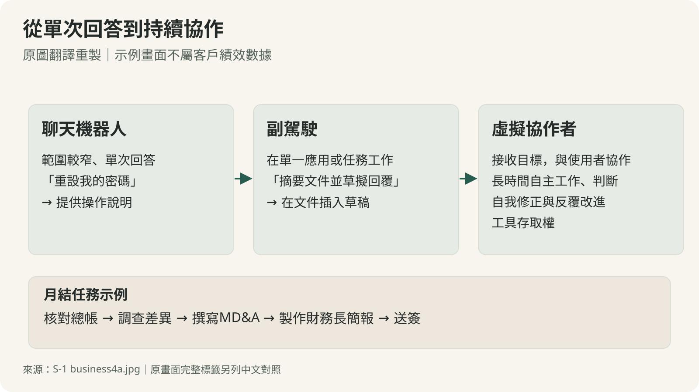
*原圖翻譯重製：聊天機器人、副駕駛與虛擬協作者。月結任務是功能示例，並非客戶績效數據。[英文原圖](https://www.sec.gov/Archives/edgar/data/2130357/000162828026067168/business4a.jpg)。*

Claude 模型提供共用能力；Platform 讓企業把模型接進自有系統，Code 主要協助程式開發，Cowork 則面向檔案、應用程式與一般知識工作。平台、產品與模型不能直接當成互不重疊的收入部門相加。原圖的產品／平台／模型關係，已另做成可在手機閱讀的中文對照。[原圖中文譯讀](figure-translations.html)

從財報來看，公司把收入分為用量式與訂閱式。2026 上半年用量式收入 130.64 億美元，訂閱式 32.22 億美元，分別約占 80.2% 與 19.8%。用量式通常在 tokens 被消耗時認列。tokens 是模型處理文字等內容的計量單位，不等同固定的一個字；訂閱通常按服務期間認列。這使收入與客戶實際投入多少工作、選擇哪些模型、任務多複雜，密切相連。[附註 2，F-26；營收認列 F-21–22](https://www.sec.gov/Archives/edgar/data/2130357/000162828026067168/anthropicpbc-sx1.htm#:~:text=The%20Company%20generates%20revenue%20from%20customers%2C%20including%20enterprises%20and%20prosumers)

**採用可以深入既有客戶，收入也可能隨使用行為迅速變動。** 席次不變，代理承接更多任務，用量仍可能上升；客戶改用較便宜的模型、減少任務或提高快取效率時，同樣的工作也未必帶來同樣收入。把這種生意直接套進固定席次軟體的想像，容易忽略收入與服務成本同時變動的特性。

公司用兩個循環說明擴張：更好的模型帶來更多使用情境與回饋；成長帶來投資，投資再推進能力。這張圖可以用來理解管理層的策略，但箭頭不會自行保證結果。回饋能否轉成可持續的模型優勢、投資能否產生足夠收入，仍要用後續數據檢驗。

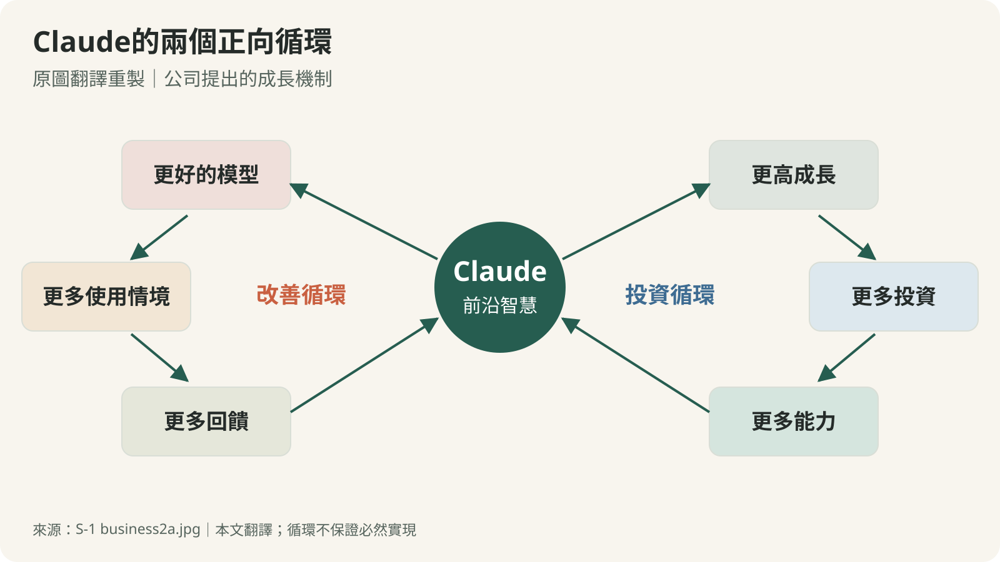
*公司提出的成長機制，非本文保證。[英文原圖](https://www.sec.gov/Archives/edgar/data/2130357/000162828026067168/business2a.jpg)。*

## 二、客戶數成長很快，900% 卻不是留客率

年支出達一定門檻的客戶，比下載量或註冊人數更接近商業採用。文件中的組織客戶，會把公司判定屬於同一組織的帳號合併；「企業採用」主要以近十二個月收入至少 10 萬美元的客戶作為觀察指標，並不是另外劃出一個嚴格的企業客戶分部。[定義，頁 2–3](https://www.sec.gov/Archives/edgar/data/2130357/000162828026067168/anthropicpbc-sx1.htm#:~:text=customers%20with%20%24100%2C000)

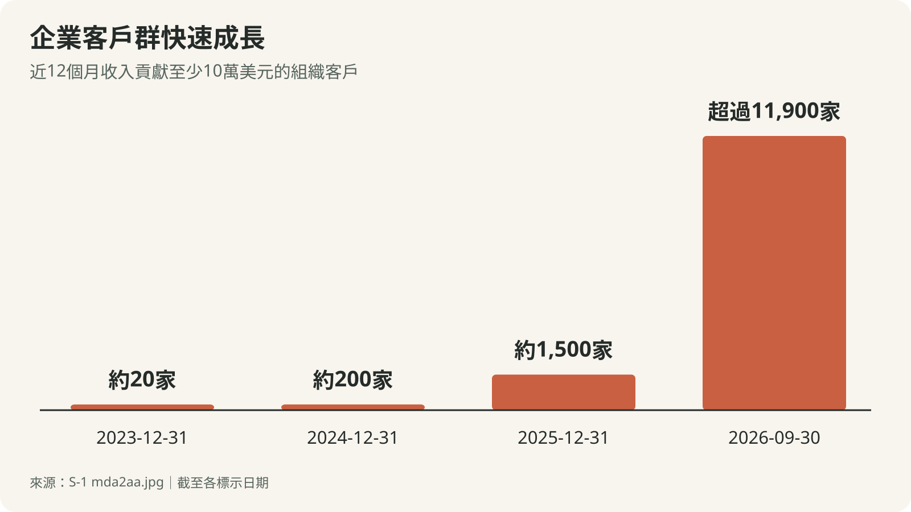
*原圖翻譯重製。各時間點為概數或下限，不能當成精確逐戶名單。[英文原圖](https://www.sec.gov/Archives/edgar/data/2130357/000162828026067168/mda2aa.jpg)。*

截至 2026 年 9 月 30 日，近十二個月收入至少 10 萬美元的客戶超過 11,900 家；至少 100 萬美元者超過 1,900 家；至少 1,000 萬美元者約 250 家。後兩組包含在前面的門檻內，不能加總成三組互斥客戶。6 月底的同門檻客戶則是 6,000 多家，也不能拿 9 月底的數量來描述上半年。[摘要，頁 9–10；MD&A，頁 149](https://www.sec.gov/Archives/edgar/data/2130357/000162828026067168/anthropicpbc-sx1.htm#:~:text=Enterprise%20Adoption%20of%20Claude)

約 900% 的淨收入留存率（NRR）是公司自訂的營運指標，更需要拆開。公司先找出一年前對應三個月內已有至少 1 美元收入的合格客戶，再用同一批客戶當期三個月收入，除以一年前對應三個月的收入，並排除 Claude Pro、Max 的固定價格訂閱者。[NRR 定義，頁 3–4；指標頁 135](https://www.sec.gov/Archives/edgar/data/2130357/000162828026067168/anthropicpbc-sx1.htm#:~:text=Net%20Revenue%20Retention)

用指數示意：如果合格舊客群一年前同季合計貢獻 100，現在約為 900，便會得到約 900% NRR。它已包含增購、縮減和流失的淨結果，也排除當期新客戶。**它表示同一批合格客戶的總收入約成為九倍，無法回答究竟留住多少家客戶。** 少數客戶的大幅擴張，就可能抵銷其他客戶流失；每家公司排除的客群不同，也會影響同業比較。

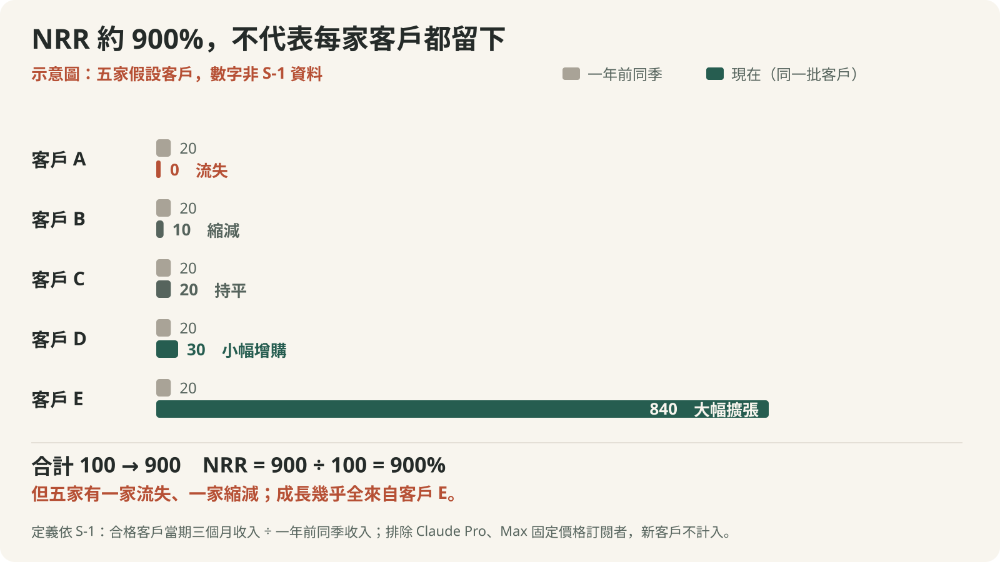
*示意圖，五家客戶與數字皆為假設，非 S-1 資料：合計由 100 變 900，NRR 即約 900%，但其中一家流失、一家縮減，成長幾乎全來自一家客戶。*

另一個容易被誤讀的是 Run-Rate Revenue。文件定義為最近 28 天用量費乘以 13，再加上衡量日每月訂閱費乘以 12。這是在短期活動上做年化，不是過去一年營收，也不是保證履約的訂單。文件有一個截至 10 月 31 日的欄位，衡量日晚於本文 10 月 29 日閱讀基準，金額仍留白；本導讀不替它填入猜測。[定義頁 4；Business 頁 195](https://www.sec.gov/Archives/edgar/data/2130357/000162828026067168/anthropicpbc-sx1.htm#:~:text=Run-Rate%20Revenue)

## 三、先把財報的時間與層次對齊

下面統一使用百萬美元，保留報表原單位，方便回查。2026 上半年應與 2025 上半年比較；2025 全年列出作為背景，不能拿半年與全年直接算同比。

| 百萬美元 | 2025 全年 | 2025 上半年 | 2026 上半年 |
|---|---:|---:|---:|
| 營收 | 4,585 | 1,163 | 16,286 |
| 算力與基礎設施費用 | 7,326 | 2,334 | 8,945 |
| 全部營業費用 | 12,645 | 3,298 | 16,979 |
| GAAP 營業損益 | −8,060 | −2,135 | −693 |
| GAAP 淨損益 | −41,965 | −12,969 | −80,748 |
| 公司調整後營業損益 | −4,854 | −1,849 | 1,618 |
| 營業活動現金流 | −2,637 | −1,513 | 3,929 |

*來源：[損益表 F-7、現金流量表 F-12–13、非 GAAP 調節頁 156–157](https://www.sec.gov/Archives/edgar/data/2130357/000162828026067168/anthropicpbc-sx1.htm#:~:text=Consolidated%20Statements%20of%20Operations,-(In%20millions)。半年數字未經查核。調整後營業損益為公司非 GAAP 指標，不能與法定報表互換。*

同期間比較，2026 上半年營收增加約 1,300%，也就是成為約 14 倍。「增加十三倍」和「成為十四倍」描述的是同一個變化，標題若混用就會多算一次。

季度數字又提供另一個角度。2026 年第二季營收 115.55 億美元、GAAP 營業利益 9.74 億美元，本文計算營業利益率約 8.4%；但是第一季虧損較大，所以合計上半年仍為營業虧損。[季度表，頁 158](https://www.sec.gov/Archives/edgar/data/2130357/000162828026067168/anthropicpbc-sx1.htm#:~:text=Quarterly%20Results%20of%20Operations)

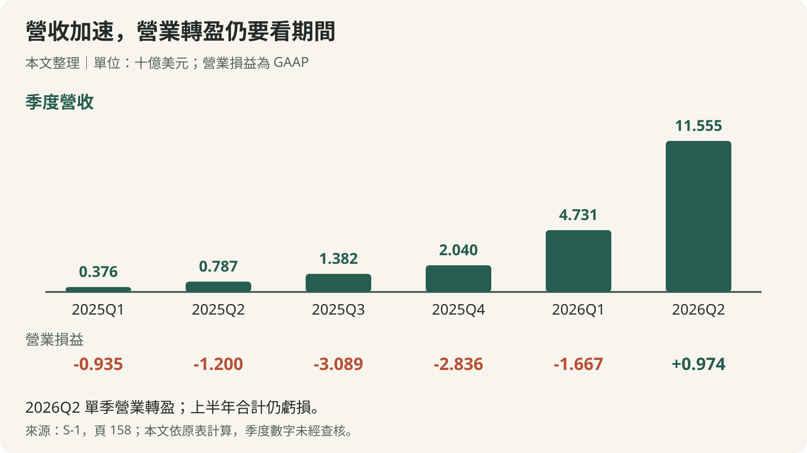
*本文依季度表整理，單位十億美元。營收與營業損益分開呈現，避免把營收成長看成等額獲利。*

這是值得重視的改善，但還不足以宣告長期獲利模式已經定型。收入基期、模型發布、預先承諾的算力何時交付，以及客戶使用節奏，都會影響季度結果。公司揭露，2026 年第三季逾 80% 收入來自截至 9 月底前六個月內發布的模型版本。本文據此判讀：維持前沿能力所需的研發，不宜簡單視為做到某一年就會消失的費用。[使用模式，頁 143](https://www.sec.gov/Archives/edgar/data/2130357/000162828026067168/anthropicpbc-sx1.htm#:~:text=Customer%20Usage%20Patterns)

## 四、85.4% 毛利率，要回到附註才看得懂

公司自 2025 年起，把損益表改成按費用性質呈現，並重編比較期間。主表列出算力、人員、銷售與合作夥伴等支出；附註 8 則另外提供按功能分類的營收成本、研發、銷售及行政費用。[會計政策 F-14；附註 8，F-39](https://www.sec.gov/Archives/edgar/data/2130357/000162828026067168/anthropicpbc-sx1.htm#:~:text=Supplemental%20Operating%20Expense%20Information)

這兩張表是在用不同方式切同一筆總費用。按性質，算力可能被拿來服務付費客戶，也可能用於研究、內部工作或免費產品；按功能，這些支出被分到營收成本、研發與其他項目。因此，**全部算力費用不等於營收成本，兩種分類也不能再加一次。**

2026 上半年，附註揭露營收成本 23.80 億美元。用營收 162.86 億減去它，得到推算毛利 139.06 億美元，毛利率約 85.4%。這是本文依附註計算，並非主表直接列示指標。若誤把全部算力費 89.45 億當營收成本，會得到約 45.1% 的餘額率，兩個比例回答的問題不同。

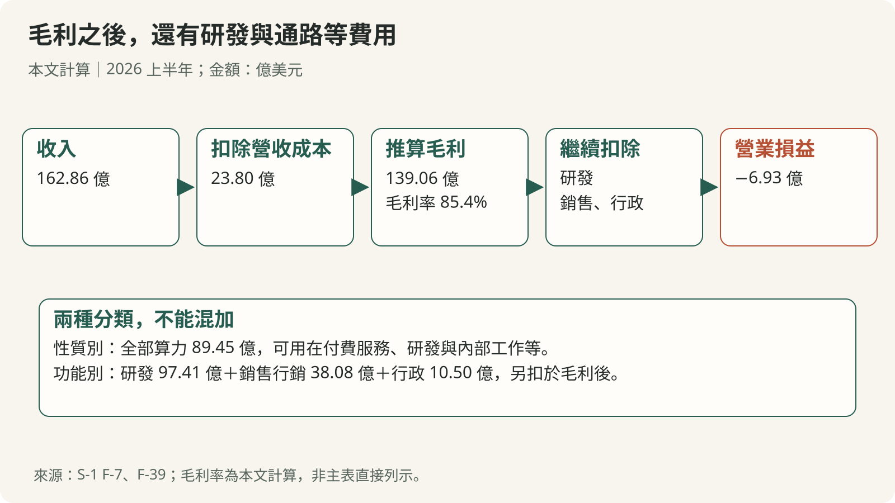
*本文依功能別費用推算：收入扣營收成本得到毛利，再扣研發、銷售與行政費用得到營業損益；全部算力費用包含不同功能用途，不能重複扣除。*

高毛利率仍需放回支出全貌。同一附註列出研發費 97.41 億、銷售與行銷 38.08 億、一般與行政 10.50 億美元。推算毛利扣除這些項目，仍是 6.93 億美元營業虧損。

通路費尤其容易藏在比較之外。公司採總額認列符合條件的雲端通路收入，通路夥伴成本則列在銷售行銷等費用。若讀者拿這個毛利率與把平台費列在營收成本的公司直接比較，可能把分類差異當成經濟優勢。判斷服務一美元收入實際留下多少資源，還需要一起看通路費、研發與後續資本需求。

原圖另展示「營收／算力與基礎設施費用」由 2025 年第一季約 0.40 倍提升至 2026 年第二季約 2.08 倍。它說明當季收入相對整體算力支出的變化，並不是毛利率，也不能單憑這個比率證明每個模型、每個客戶或每個 token 的單位經濟都改善相同幅度。[MD&A，算力效率相關段落](https://www.sec.gov/Archives/edgar/data/2130357/000162828026067168/anthropicpbc-sx1.htm#:~:text=Compute%20is%20the%20most%20significant%20operating%20cost%20in%20our%20business)

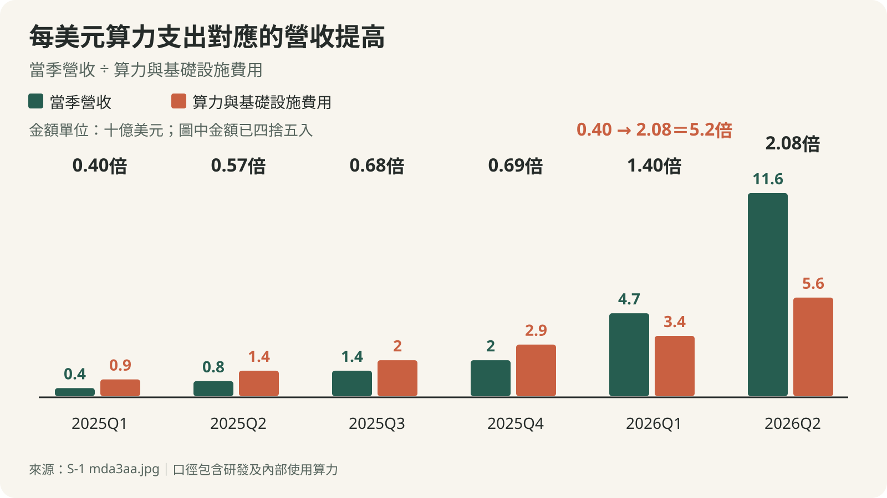
*原圖翻譯重製。季度金額依原圖四捨五入，比例口徑包含研究與內部使用算力。[英文原圖](https://www.sec.gov/Archives/edgar/data/2130357/000162828026067168/mda3aa.jpg)。*

## 五、807.48 億美元淨損，為何沒有變成同額燒錢

營業損益以下還有金融工具、公允價值、利息與稅。2026 上半年的可轉債、衍生負債及 SAFE 公允價值變動損失為 723.88 億美元，已占 GAAP 淨損的大部分。另有其他特定金融工具的公允價值調整 87.20 億美元，不應與整項其他費用混為一談。[損益表 F-7；調節表頁 157](https://www.sec.gov/Archives/edgar/data/2130357/000162828026067168/anthropicpbc-sx1.htm#:~:text=Change%20in%20fair%20value%20of%20convertible%20notes%2C%20derivative%20liabilities%2C%20and%20SAFEs%20for%20the%20six%20month)

當某些融資工具需要隨估值重新衡量時，公司估值上升，也可能讓相關負債帳面價值上升，形成損失。這筆會計損失不是當期支付同額現金；但股份轉換、稀釋與條款仍可能影響股東，不能因為非現金就當作沒有經濟意義。

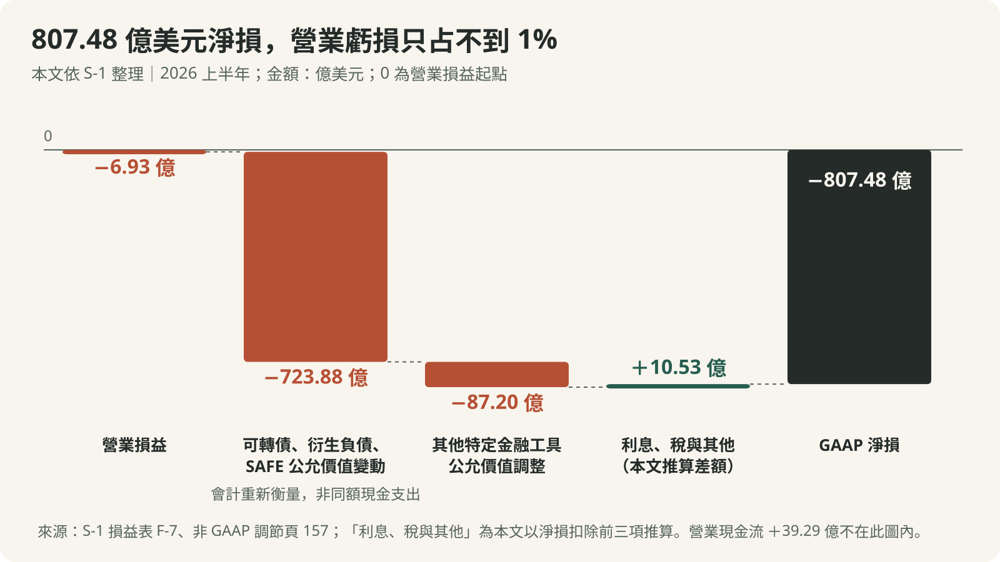
*本文依 S-1 損益表與非 GAAP 調節整理：營業虧損 6.93 億，約占淨損 0.9%；「利息、稅與其他」是以淨損扣除前三項推算的差額。營業現金流另列，不在此橋接內。*

各調整後指標排除的項目不同：營業損益主要加回股份報酬與非現金公益支出等，淨損益另調整部分金融工具變動。以 2026 上半年營業損益為例：

| 百萬美元 | 調節金額 |
|---|---:|
| GAAP 營業虧損 | −693 |
| 加回股份報酬 | 2,185 |
| 加回非現金公益支出 | 126 |
| 調整後營業利益 | 1,618 |

*來源：[非 GAAP 調節，頁 156](https://www.sec.gov/Archives/edgar/data/2130357/000162828026067168/anthropicpbc-sx1.htm#:~:text=certain%20non-GAAP%20financial%20measures%2C%20as%20described%20below)。2025 年另排除 Bartz 和解費；公司排除某項費用，不代表該項沒有經濟成本。*

**調整後獲利可以協助辨識營運趨勢，不能代替對排除項目的判斷。** 股份報酬可能稀釋持股，公益配置也是公司資源安排，和解則可能真的需要付款。原圖的調整後營業利益率改善，應與 GAAP 結果並讀。

上市也可能改變股份報酬的認列節奏。附註指出，截至 6 月底，部分限制型股票單位（RSU）尚未達到績效條件的認列門檻；若視為當時已達成，累計費用約 29 億美元，另有約 237 億美元尚未認列成本，預期加權約 2.1 年認列。這是依當時條件估算，不能直接當成實際 IPO 當日的確定費用，也不能直接加進歷史半年費用。[附註 10，F-52](https://www.sec.gov/Archives/edgar/data/2130357/000162828026067168/anthropicpbc-sx1.htm#:~:text=The%20Company%20grants%20RSUs%20to%20employees%20and%20the%20RSUs%20vest%20upon)

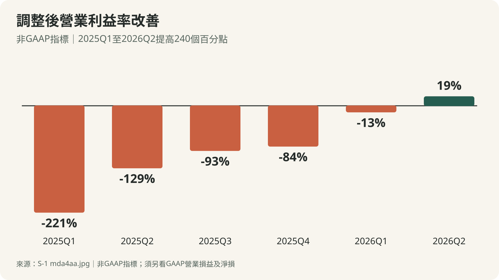
*原圖翻譯重製：2025 年第一季至 2026 年第二季，由 −221% 到 19%，提高 240 個百分點；這是非 GAAP 指標。[英文原圖](https://www.sec.gov/Archives/edgar/data/2130357/000162828026067168/mda4aa.jpg)。*

現金流則要回到收付款。2026 上半年營業現金流 39.29 億美元，其中既有非現金費用加回，也有營運資金變動：應收帳款增加帶來約 49.82 億美元現金減項，預付等資產變動、應付與應計負債、遞延收入的變動則帶來正向影響。收款及付款時點會使現金流與當期收入、利益錯開。[現金流與 MD&A 頁 169](https://www.sec.gov/Archives/edgar/data/2130357/000162828026067168/anthropicpbc-sx1.htm#:~:text=Cash%20provided%20by%20operating%20activities%20was%20%243.9%20billion%20for%20the%20six%20months)

截至 6 月底，現金及約當現金加短期投資合計約 1,316.51 億美元；同一半年融資活動現金流為 1,107.74 億美元。這個現金部位很大，也清楚反映外部資本的角色。投資活動流出 171.81 億美元主要包含短期投資交易，不能全部當成購買設備；購置不動產及設備是 4.82 億美元。[資產負債表 F-5–6；現金流 F-12–13](https://www.sec.gov/Archives/edgar/data/2130357/000162828026067168/anthropicpbc-sx1.htm#:~:text=Total%20current%20assets)

因此，把營業現金流減掉設備支出後得到一個正數，再宣告資金循環已經完成，也太早了。未來多年算力付款、租賃、部署條件及資金取得方式，仍需接著讀。

## 六、算力長約：需求可以變，最低付款不會自動跟著變

前沿模型需要先取得算力，再用模型和應用吸引需求。預先承諾可能確保供給、改善單位條件，也把需求尚未發生時的支出風險留給公司。當算力用在研究、內部工具與付費服務之間時，管理層還必須決定哪一種工作負載最值得先做。

附註 13 揭露，截至 2026 年 6 月 30 日，不可取消採購協議中的預期固定或最低保證承諾約 2,656 億美元，期限一至二十年；沒有固定最低美元金額的其他安排不包含在這個數字內。MD&A 較新、涵蓋更廣的總承諾欄位仍留白。**已知的六月數字不能拿去填補較新口徑的空白。**[附註 13，F-58；MD&A 頁 170–171](https://www.sec.gov/Archives/edgar/data/2130357/000162828026067168/anthropicpbc-sx1.htm#:~:text=In%20November%202025%2C%20we%20entered%20into%20an%20agreement%20with%20Microsoft)

較新的數字仍可在後續事項找到：附註 17 另列六月底後新增或修訂安排的未來最低付款約 2,450 億美元，部分附契約條件，另有短期合約不可取消最低付款約 210 億美元。這些不是完整總額的調節表，不能直接與六月底數字相加。[附註 17，F-64–65](https://www.sec.gov/Archives/edgar/data/2130357/000162828026067168/anthropicpbc-sx1.htm#:~:text=Subsequent%20Events%20%28Unaudited%29)

| 文件列示安排 | 金額 | 付款期間或條件 |
|---|---|---|
| Microsoft | 至少 449 億美元 | 2026/11–2033/5；有特定例外條款 |
| Google | 至少約 1,145 億美元 | 2026/4–2033/7；最低消費差額安排 |
| Amazon | 至少 1,100 億美元 | 2026/5–2036/4；最低消費差額安排 |
| 額外 TPU | 估計 1,250–1,500 億美元 | 2028–2031 交付，取決於部署、容量與定價等 |

*來源：MD&A 頁 170–171。這些是不同期間與條件的安排，不能彼此直接相加，也不能再加到六月底 2,656 億美元上。估計數與固定最低承諾不屬同一性質。*

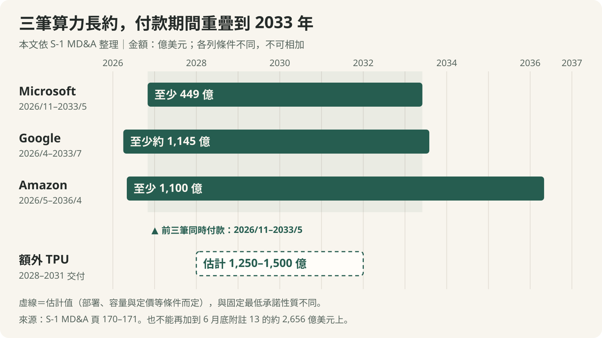
*本文依 S-1 MD&A 頁 170–171 整理。三筆最低付款期間在 2026/11–2033/5 同時進行；額外 TPU 為估計值，與固定最低承諾性質不同，各列不可相加。*

公司採多晶片與混合基建策略，涵蓋 AWS Trainium、Google TPU、NVIDIA 及 AMD GPU，並逐步結合雲端算力、直接設備與租賃機房。這有機會改善供給彈性，但也帶來晶片適配、資料中心交付、電力、施工和融資的執行問題。宣布取得的容量、已可用的容量與已付費且產生收入的容量，不能視為同一件事。[Business，頁 205–206](https://www.sec.gov/Archives/edgar/data/2130357/000162828026067168/anthropicpbc-sx1.htm#:~:text=Anthropic%20Direct%20also%20lets%20us%20separate%20our%20commitment%20to%20data%20center)

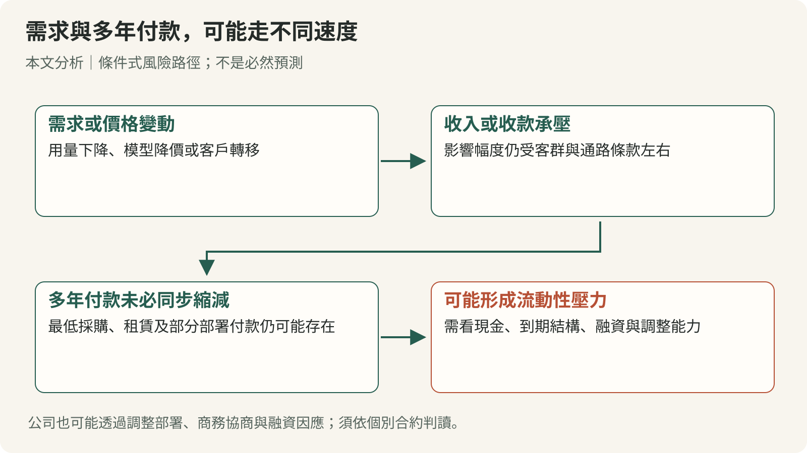
*本文分析的條件式風險路徑，非預測公司必定違約；實際結果取決於合約、現金、融資與調整能力。*

資金安排也不能只看公告上限。有些投資分期且附營收、算力或交付條件；部分基建融資只能支付指定租金，而非自由用途現金。將「最多可取得」直接加進現金餘額，就會高估可立即動用的資源。[融資安排，頁 164–168](https://www.sec.gov/Archives/edgar/data/2130357/000162828026067168/anthropicpbc-sx1.htm#:~:text=The%20following%20table%20summarizes%20the%20notes%20outstanding%20under%20our%20NPAs)

同樣道理，可轉債的帳面公允價值與未償本金要分開。6 月底分別約為 1,085.66 億與 62.03 億美元。文件預期相關工具轉換股份，但仍受持股上限與展期等條件影響；不能把帳面價值當成近期必須現金償還的本金，也不能假定 IPO 完成後全部立即消失。

## 七、客戶分散之後，通路與收入品質仍要看

終端客戶很多，不代表分發與收款渠道也同樣分散。公司揭露，經 CSP 雲端市場產生的收入占比，從 2023 年約 11%、2024 年 32%、2025 年 47%，來到 2026 上半年約 48%。同一平台可能同時是供應商、通路或投資人，判讀利益關係時需要逐筆看條款。[風險因素，頁 57–58；多雲分發](https://www.sec.gov/Archives/edgar/data/2130357/000162828026067168/anthropicpbc-sx1.htm#:~:text=Multi-Cloud%20Distribution)

雲端通路讓客戶沿用既有採購與安全安排，降低導入阻力；但通路條件、匯款節奏或服務中斷，也可能同時影響多個終端客戶。保有直接客戶關係，不等於每次平台切換都沒有成本。

這些關係還可能包含競爭。文件把 Google 與 OpenAI 列為主要模型競爭者，也提醒大型科技公司可以把 AI 綁入既有產品、補貼價格。Anthropic 推出自己的應用時，又可能與原本使用 Claude 的軟體客戶搶生意。因此，模型能力能否持續轉成價格、用量與客戶關係，仍是要逐季檢驗的問題。[競爭風險，頁 40–41、56](https://www.sec.gov/Archives/edgar/data/2130357/000162828026067168/anthropicpbc-sx1.htm#:~:text=The%20market%20for%20AI%20models%2C%20platforms%2C%20and%20applications%20is%20rapidly%20evolving)

集中度又必須分期間。上半年財報附註有一名匿名 Customer C 占營收 11%；截至 9 月底的前九月揭露則說，沒有單一客戶超過 10%，前五合計約 25%。兩者描述不同期間，並不矛盾，也不能據此猜匿名客戶的真實身分。[附註 1，F-15；風險因素頁 57](https://www.sec.gov/Archives/edgar/data/2130357/000162828026067168/anthropicpbc-sx1.htm#:~:text=one%20or%20more%20of%20our%20top%20customers%20or%20disruption%20through%20those%20channels%20could%20adversely%20affect)

收入持續性還有一個少見的揭露：公司估計 2026 年前九月約 5%–7% 收入，來自事後判定違反使用政策或商業條款的客戶。服務提供、認列收入與查明違規之間存在時差；後續停權可能讓部分用量不再延續。這並不等於收入虛構，也不表示該比例會在同一天全部消失，但值得從成長率中另外辨識。公司預期此比例會下降，因為 8–9 月已加強偵測與執法，並提醒這可能對營收成長造成不利影響。[MD&A，頁 145–146](https://www.sec.gov/Archives/edgar/data/2130357/000162828026067168/anthropicpbc-sx1.htm#:~:text=Based%20on%20our%20detection%20and%20review%20process)

原文件用大量案例展示導入成果。這些案例能說明客戶把 Claude 放進哪些流程，卻不是隨機抽樣的平均投資報酬。導讀附上的 [42 張原圖中文對照](figure-translations.html)涵蓋全部圖像，其中 20 張案例圖實際有 21 個案例。閱讀節省工時、產出倍數或訂單差異時，仍應保留各自的基期、適用團隊與自報性質。

例如，Mozilla 的案例談漏洞與修補流程，UST 談晶片驗證，Shy Bird 談餐廳出單。它們共同說明使用場景已超出寫作與聊天；但把個別客戶的百分比當成每家企業導入後都會得到的成效，就跨過了原始證據能支持的範圍。

安全定位也有相同的兩面。公司主張，可信賴與可問責能協助爭取關鍵企業工作負載；事故則可能對信任、責任與產品節奏造成衝擊。安全投資可以有商業價值，但不能由公司強調安全，就推出系統不會失誤的結論。[安全與商業目標，風險因素頁 50–55](https://www.sec.gov/Archives/edgar/data/2130357/000162828026067168/anthropicpbc-sx1.htm#:~:text=Balancing%20Safety%20and%20Commercial%20Objectives)

## 八、買到 A 股，還需要看懂另外四類股份

一般上市公司的直覺是：持股越多，經濟利益與表決影響力大致越多。Anthropic 的架構刻意拆開這些關係。它是德拉瓦州公益公司，董事須平衡股東金錢利益、受公司行為重大影響者的利益，以及章程所列公共利益目的。[治理架構，頁 242–253](https://www.sec.gov/Archives/edgar/data/2130357/000162828026067168/anthropicpbc-sx1.htm#:~:text=We%20are%20incorporated%20as%20a%20PBC%20under%20Delaware%20law%2C%20a%20structure%20that%20enables)

| 股份 | 經濟權利與持有人 | 主要治理作用 |
|---|---|---|
| A 股 | 公開市場等股東；具有經濟權利 | 每股一票，但受特殊股類結構影響 |
| N 股 | 策略夥伴等；經濟權利大致同 A | 原則無表決權；特定轉讓後可轉 A |
| T 股 | LTBT；無經濟權利 | 一般選任／解任 T 董事，另有例外程序 |
| F 股 | Founder LLC 持一股；無經濟權利 | 一般股東事項合計 50.1% 票權 |
| E 股 | 不含共同創辦人的員工；無經濟權利 | 特定 T 董事及部分信託變更等事項 |

*依文件主要權利整理。T／F／E 在清算時形式上有面額受領條款；表中「無經濟權利」沿用文件的主要分類，並非宣稱所有法律情境都絕對零元。*

預期 IPO 後，董事會法定七席，其中四席為 T 董事，初始包含一席空缺；其餘三席由 A 與 F 合併投票選任。LTBT 透過 T 股一般選任 T 董事；Founder LLC 則在一般股東表決持有合計 50.1% 票權，這不表示創辦人持有 50.1% 經濟股權。[董事選任，頁 244–245；管理頁 257](https://www.sec.gov/Archives/edgar/data/2130357/000162828026067168/anthropicpbc-sx1.htm#:~:text=As%20the%20sole%20holder%20of%20Class%20T%20common%20stock%2C%20the%20LTBT%20generally%20has%20the%20authority)

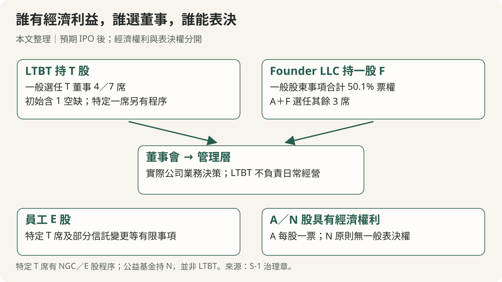
*本文依 S-1 整理，重點在不同權利的分工。LTBT 並非日常經營者；董事會與管理層負責業務決策。*

這套架構還有制衡與修改程序。某一個特定 T 董事席位的提名、無因解任等事項，需提名暨治理委員會同意，或走 E 股員工表決路徑；不能把 LTBT 畫成不受條件限制的單一控制者。創辦人一般表決權也不能繞過依法需要的董事會批准。F 股存在日落觸發與過渡機制，但不是過幾年就自動恢復一般股權結構。[治理頁 245–248、251](https://www.sec.gov/Archives/edgar/data/2130357/000162828026067168/anthropicpbc-sx1.htm#:~:text=co-founders%20have%20been%20instrumental%20in%20building%20our%20leadership%20position)

**對 A 股股東而言，公司做得好與自己能否改變公司方向，是兩個問題。** 應該評估的是：經濟回報是否足以補償表決影響力的限制，以及公益目的、安全與商業目標衝突時，公司依什麼程序分配資源。

公益資產安排也與 LTBT 不同。Public Benefit Fund 持有 N 股；初始配置相當於 2026 年 6 月底、假設 Amazon 票據全數轉換的完全稀釋基礎的 5%。每當股價較前一個里程碑再漲 50%，且符合連續 120 個交易日中至少 90 日高於門檻等條件，董事會得酌情再增發至多 2% 股數用於公益；這可以重複發生，但不是自動增發。LTBT 主要是 T 股治理機制，公益基金則持有經濟資產，兩者不能合併成一個「公益信託」。[公益安排，頁 144–145、250](https://www.sec.gov/Archives/edgar/data/2130357/000162828026067168/anthropicpbc-sx1.htm#:~:text=Our%20commitment%20to%20public%20benefit%20extends%20to%20how%20we%20deploy%20our%20resources)

## 九、下一份修訂文件，應該帶著哪些問題讀

原圖把使命、研究、算力、企業採用與財務模式連成一個整體。這是管理層提出的假說：前沿能力帶動需求，需求支應投資，安全與信任提高可承接工作的價值。讀者要做的，是檢查各段之間有沒有接上。

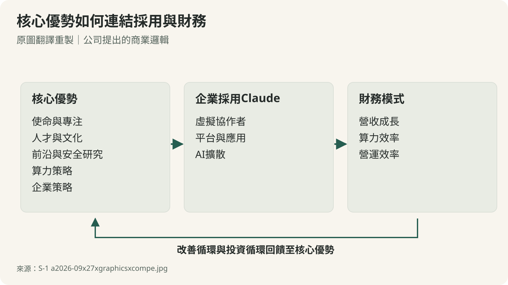
*原圖翻譯重製：公司提出的商業邏輯，不能當成每條因果均已獨立驗證。[英文原圖](https://www.sec.gov/Archives/edgar/data/2130357/000162828026067168/a2026-09x27xgraphicsxcompe.jpg)。*

| 後續觀察 | 希望看見的證據 | 不能直接推論的結論 |
|---|---|---|
| 收入與客戶 | 相同期間營收、客戶分布、指標定義持續一致 | NRR 高就沒有流失 |
| 單位經濟 | 服務成本、通路費與整體費用的共同變化 | 毛利高就已能穩定獲利 |
| 算力投資 | 可用容量、利用率、最低付款與到期分布 | 容量公告等於已產生收入 |
| 現金來源 | 營運資金變動、融資實際到帳與用途限制 | 有融資上限就等於現金 |
| 股東權利 | 發行價格、股數、稀釋、轉換與治理修訂 | 公司成長就等於每股同幅成長 |

這份 S-1 還不足以完成發行估值：缺少最終價格與股數，就無法算出確定的發行市值或完整稀釋結果。可以先把經濟問題釐清，等修訂文件補上交易條件，再把價格帶回來。

接下來要盯的只有兩件事：收入長得夠不夠快，足以支付維持前沿能力和履行算力長約的成本；付完之後剩下多少，又有多少會落到普通股的每股價值上。

## 原圖中文對照與閱讀方式

[開啟 42 張原圖中文對照](figure-translations.html)：保留英文原圖、原始來源與中文標籤／指標翻譯。六組資訊圖另重製繁中 SVG；產品平台圖改成中文表格；長篇創辦人信與案例敘事提供明確標示的摘要譯讀，不冒稱全文逐字翻譯。品牌、公司、產品與模型專名保留原名。

本文新繪的季度、費用分類、治理與風險圖標示為「本文整理／分析」，原圖重製則附原圖連結。圖中的金額、百分比與期間依對應來源，示意箭頭不代表必然的預測結果。

## 製作說明：這篇導讀由 AI 模型完成

本導讀由 Codex 執行環境中的 GPT-6 系列模型統籌分析與撰稿，研究代理分別處理財務、業務治理與原圖翻譯，再由獨立代理核對事實與可讀性。這些核對用於檢查文件解讀，並非對公司營運真實性的獨立查核。本導讀不是人類分析，未經人工逐句校稿。

圖片中的英文由 AI 模型讀取、翻譯與核對，資訊圖以 SVG 重製；本文補充圖亦以程式繪製，沒有用生成式插畫表現財務數據。重要資料以 SEC 第一手文件為基準；公司自報指標、公司觀點與本文計算在對應段落區分。原圖的長篇敘事採摘要譯讀，完整對照見 [原圖中文頁](figure-translations.html)。

## 來源清單

- [Anthropic, PBC，Form S-1，自署 2026-10-26](https://www.sec.gov/Archives/edgar/data/2130357/000162828026067168/anthropicpbc-sx1.htm)：本文主來源。章頁：定義 1–4；MD&A 132–177；Business 178–241；治理 242–253；財報與附註 F-1 起。財務年度與半年資料的查核狀態依文中說明。
- [損益表與財務報表索引](https://www.sec.gov/Archives/edgar/data/2130357/000162828026067168/anthropicpbc-sx1.htm#:~:text=Consolidated%20Statements%20of%20Operations,-(In%20millions)：F-5–13，資產負債、損益與現金流。
- [補充功能別費用](https://www.sec.gov/Archives/edgar/data/2130357/000162828026067168/anthropicpbc-sx1.htm#:~:text=Supplemental%20Operating%20Expense%20Information)：F-39，本文毛利推算基礎。
- [基礎設施服務安排](https://www.sec.gov/Archives/edgar/data/2130357/000162828026067168/anthropicpbc-sx1.htm#:~:text=In%20November%202025%2C%20we%20entered%20into%20an%20agreement%20with%20Microsoft)：頁 170–171；並讀附註 13 F-58，注意時點與範圍。
- [治理與股份權利](https://www.sec.gov/Archives/edgar/data/2130357/000162828026067168/anthropicpbc-sx1.htm#:~:text=We%20are%20incorporated%20as%20a%20PBC%20under%20Delaware%20law%2C%20a%20structure%20that%20enables)：頁 242–253；股份細節另見 292 頁起。
- [全部原圖的繁中對照及逐圖來源](figure-translations.html)：原圖屬申報者資料；案例成果保留公司／客戶自報性質。

資料閱讀基準：2026-10-29。不同時點與不同定義的數字不混用；後續修訂應回到新的申報版本核對。
