# 原圖中文對照：Anthropic S-1的42張圖片

本頁由AI模型完成讀圖、翻譯與整理，未經人工逐句校稿。

[回到深度導讀](index.html)

資訊圖的簡短標籤完整翻譯；8頁創辦人信及20張客戶案例圖採「摘要譯讀／圖內指標翻譯」，不代表全文逐字翻譯。品牌與模型專有名稱保留原名。20張案例圖包含21個案例。

## 01. Anthropic標誌

品牌原名保留。

[SEC原圖](https://www.sec.gov/Archives/edgar/data/2130357/000162828026067168/a2026-10x24coverxheadera.jpg) · PDF實體頁2

品牌標誌，保留原名，不需文字翻譯。

## 02. 創辦人信：AI潛力與投資人應理解的四件事

摘要譯讀／圖內指標翻譯。

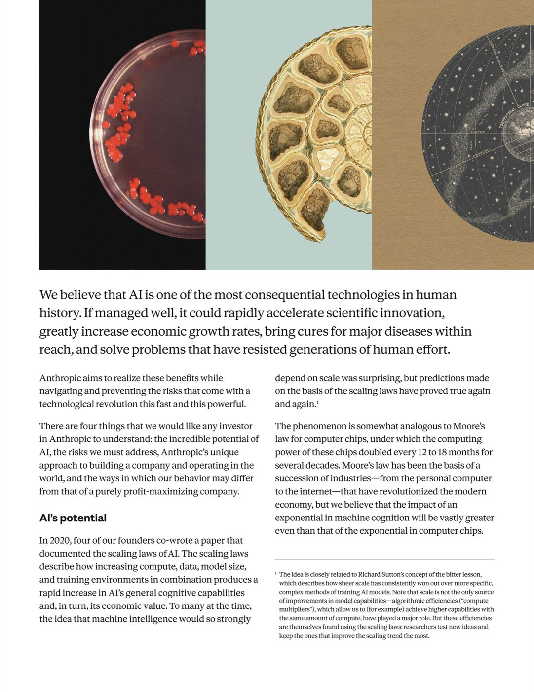

[SEC原圖](https://www.sec.gov/Archives/edgar/data/2130357/000162828026067168/a2026-10x25pg1a.jpg) · PDF實體頁3

創辦人認為，AI若受到妥善管理，可能加速科學創新、經濟成長及疾病治療；這是公司的願景與判斷。信中請投資人同時理解技術潛力、風險、公司方法及其與一般營利企業的差異。公司將增加算力、資料、模型規模及訓練環境帶來的能力提升，類比為晶片領域的摩爾定律，但這項類比不構成未來成長保證。

圖內標籤與重點：

- AI的潛力
- AI的風險
- Anthropic獨特的經營方式
- 公司行為可能與純粹追求利潤最大化的企業不同

補充：創辦人信對AI未來潛力的描述屬公司觀點，並非已實現的財務成果。

## 03. 創辦人信：企業部署與三種社會效益

摘要譯讀／圖內指標翻譯。

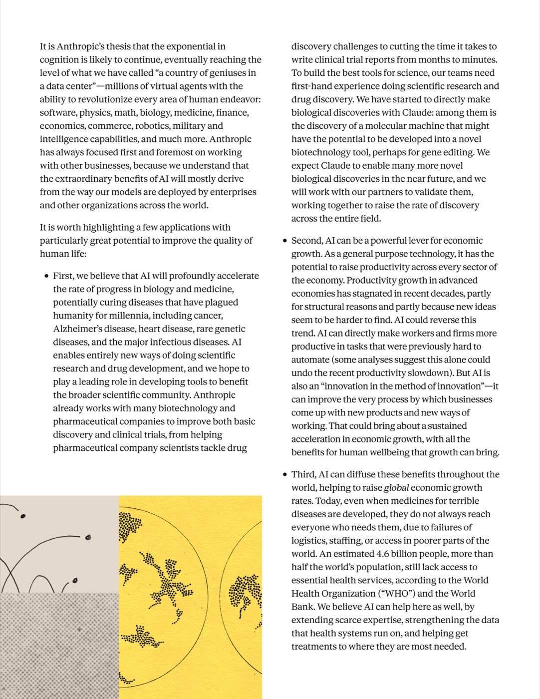

[SEC原圖](https://www.sec.gov/Archives/edgar/data/2130357/000162828026067168/a2026-10x25pg2a.jpg) · PDF實體頁4

公司把企業部署視為AI效益擴散的重要途徑。信中列舉藥物探索與臨床試驗、提高企業生產力，以及將稀缺專業知識帶到資源不足地區。文中提及研究團隊使用Claude進行生物學探索，也引述全球仍有約46億人缺乏基本健康服務；這些論述描述潛在機會，不能直接視為公司可取得的收入。

圖內標籤與重點：

- 加速生物與醫學研究
- 提升生產力與創新效率
- 讓專業能力普及至全球

| 數值 | 原圖對應意義 |
|---|---|
| 約46億人 | 信中引述缺乏基本健康服務的人口 |

## 04. 創辦人信：公共服務與風險的起點

摘要譯讀／圖內指標翻譯。

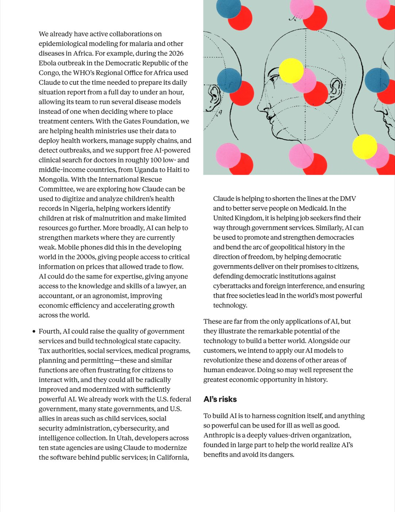

[SEC原圖](https://www.sec.gov/Archives/edgar/data/2130357/000162828026067168/a2026-10x25pg3a.jpg) · PDF實體頁5

公司列舉WHO非洲區域辦公室、蓋茲基金會與國際救援委員會等合作情境，主張AI可改善疫情報告、醫療資料與資源分配。信中同時指出，AI的推理能力可能被用於善，也可能被用於惡；這是後續風險與特殊治理安排的出發點。

圖內標籤與重點：

- 改善政府服務與科技能力
- 協助公共衛生與人道援助
- AI也可能被用於造成傷害

| 數值 | 原圖對應意義 |
|---|---|
| 不到1小時 | 公司稱WHO疫情日報準備時間由一整天縮短至此 |
| 約100國 | 公司稱免費AI臨床搜尋服務涵蓋的中低收入國家 |

## 05. 創辦人信：四類風險與市場外部性

摘要譯讀／圖內指標翻譯。

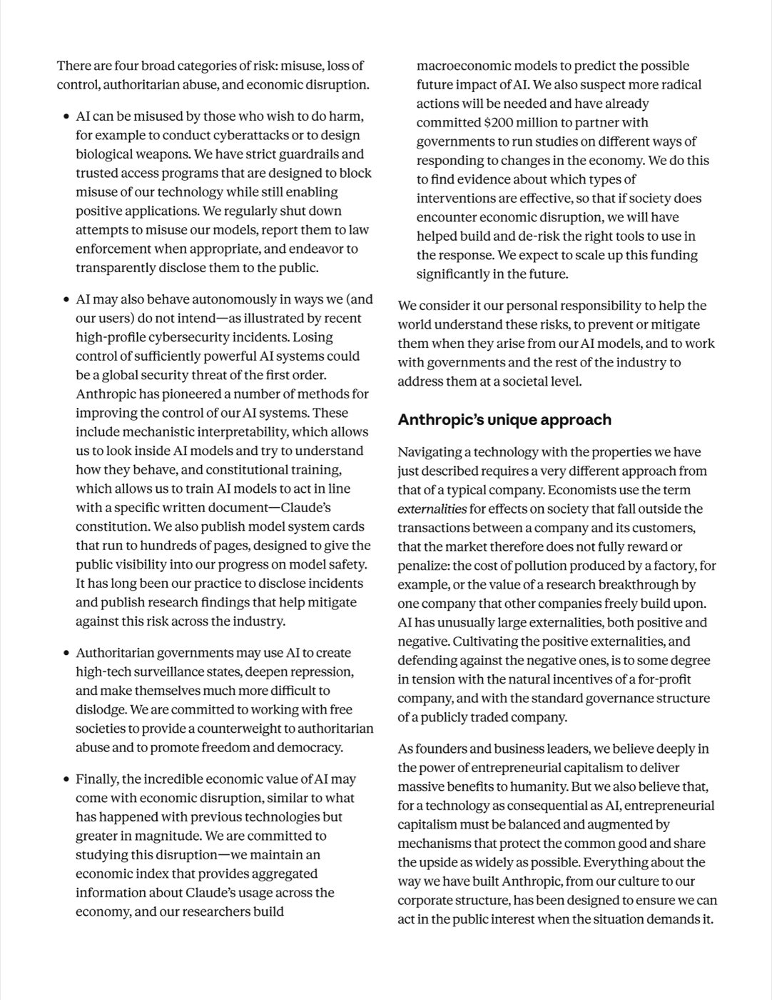

[SEC原圖](https://www.sec.gov/Archives/edgar/data/2130357/000162828026067168/a2026-10x25pg4a.jpg) · PDF實體頁6

創辦人將AI風險分成惡意濫用、系統失控、威權壓迫及經濟衝擊，並說明安全訓練、機制可解釋性與政策研究等回應。信中表示，AI具有很大的正負外部性，因此一般營利誘因與上市公司治理可能不足以處理全部影響；公司據此解釋公共利益導向的制度設計。

圖內標籤與重點：

- 濫用
- 失去控制
- 威權政府濫用
- 經濟衝擊
- AI的社會影響並不完全反映在市場交易中

| 數值 | 原圖對應意義 |
|---|---|
| 2億美元 | 信中稱已承諾與政府合作研究經濟變化的政策回應 |

## 06. 創辦人信：文化、捐股與權力分配

摘要譯讀／圖內指標翻譯。

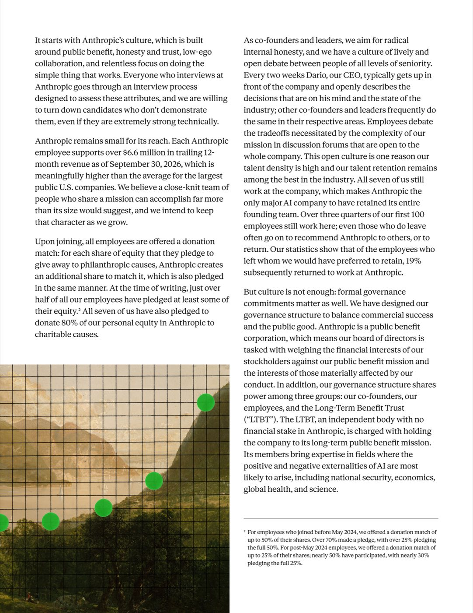

[SEC原圖](https://www.sec.gov/Archives/edgar/data/2130357/000162828026067168/a2026-10x25pg5a.jpg) · PDF實體頁7

公司主張高人才密度、公開內部討論與使命一致性是組織優勢。信中稱每名員工支撐的近12個月營收超過660萬美元，七位共同創辦人都承諾捐出80%的個人Anthropic股權；另設員工捐股配捐。這些文化敘述與捐贈承諾應與股東實際權利分開閱讀。

圖內標籤與重點：

- 公共利益、誠實、信任與低自我合作
- 創辦人、員工與長期利益信託共同參與治理
- 公共利益公司須權衡股東利益與公共利益使命

| 數值 | 原圖對應意義 |
|---|---|
| 超過660萬美元 | 截至2026-09-30近12個月每員工營收 |
| 80% | 七位共同創辦人承諾捐出的個人股權比例 |

補充：配捐註腳：2024年5月前加入者上限為其股權50%；之後加入者上限25%。

## 07. 創辦人信：董事席次、公益股權與投資人預期

摘要譯讀／圖內指標翻譯。

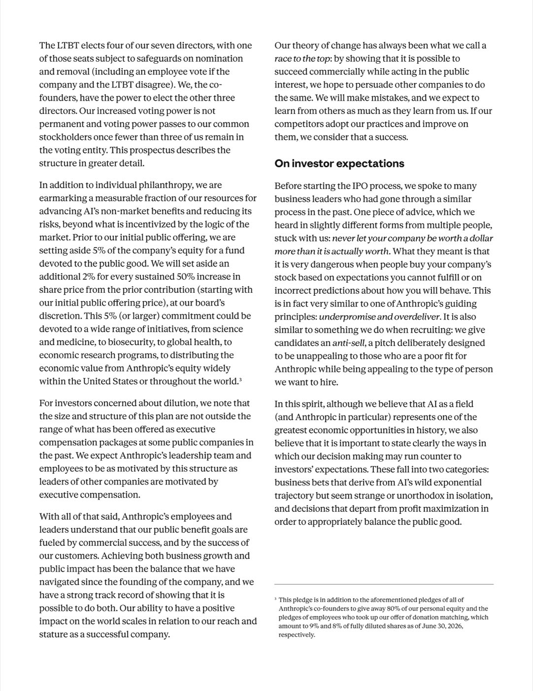

[SEC原圖](https://www.sec.gov/Archives/edgar/data/2130357/000162828026067168/a2026-10x25pg6a.jpg) · PDF實體頁8

信中說明信託的董事多數席次、創辦人保留的其他董事選任權，以及創辦人強化表決權的存續條件。公司擬於上市前配置5%股權於公益基金，後續依股價表現由董事會酌定增提。對一般股東而言，這些安排同時涉及控制權、使命承諾與未來稀釋。

圖內標籤與重點：

- LTBT選出7席董事中的4席
- 共同創辦人選出其餘3席
- 上市前預留5%股權供公益基金使用
- 股價每持續上升50%，董事會得再配置2%股權
- 公司希望投資人理解其行為與取捨

| 數值 | 原圖對應意義 |
|---|---|
| 4／7席 | LTBT選任董事 |
| 3／7席 | 創辦人選任董事 |
| 5% | 上市前公益基金股權配置 |
| 2% | 每次符合股價條件後可由董事會酌定增配 |

補充：「持續增加50%」的具體期間與法定條件以正文及章程為準；不是自動每漲50%即必定發股。；圖中註腳：創辦人捐股及員工捐股承諾，約分別占2026-06-30 fully diluted股數9%及8%。；治理正文補充：上市後法定7席，T類一般選任4席，初始為3名在任及1席空缺；另3席由A與F類合併投票，F類一般事項持50.1%表決權。特定T席另受提名、移除與員工表決程序約束，不能將此圖解讀為信託無條件控制所有決策。

## 08. 創辦人信：大額前置投資與不追求部分短期收入

摘要譯讀／圖內指標翻譯。

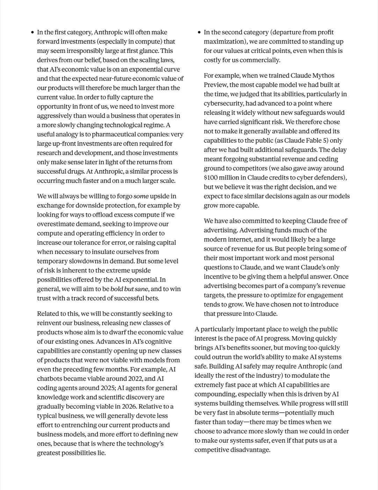

[SEC原圖](https://www.sec.gov/Archives/edgar/data/2130357/000162828026067168/a2026-10x25pg7a.jpg) · PDF實體頁9

公司明言可能進行表面上極為龐大的前置投資，並透過出售多餘算力、提升效率及融資管理風險；它也可能持續自我替代產品。信中以Mythos Preview延後普及為例，說明安全判斷可能犧牲收入，並表示Claude不置入廣告。這些是投資人須納入預期的經營取捨。

圖內標籤與重點：

- 願意提前大幅投資算力
- 願意為降低下檔風險而放棄部分上檔
- 持續推出可能取代既有產品的新產品
- 可能因安全考量延遲模型釋出
- 承諾Claude不置入廣告
- 必要時可能放慢能力推進速度

| 數值 | 原圖對應意義 |
|---|---|
| 約1億美元 | 公司稱提供給網路防禦者的Claude使用額度 |

## 09. 創辦人信：長期價值與七位共同創辦人署名

摘要譯讀／圖內指標翻譯。

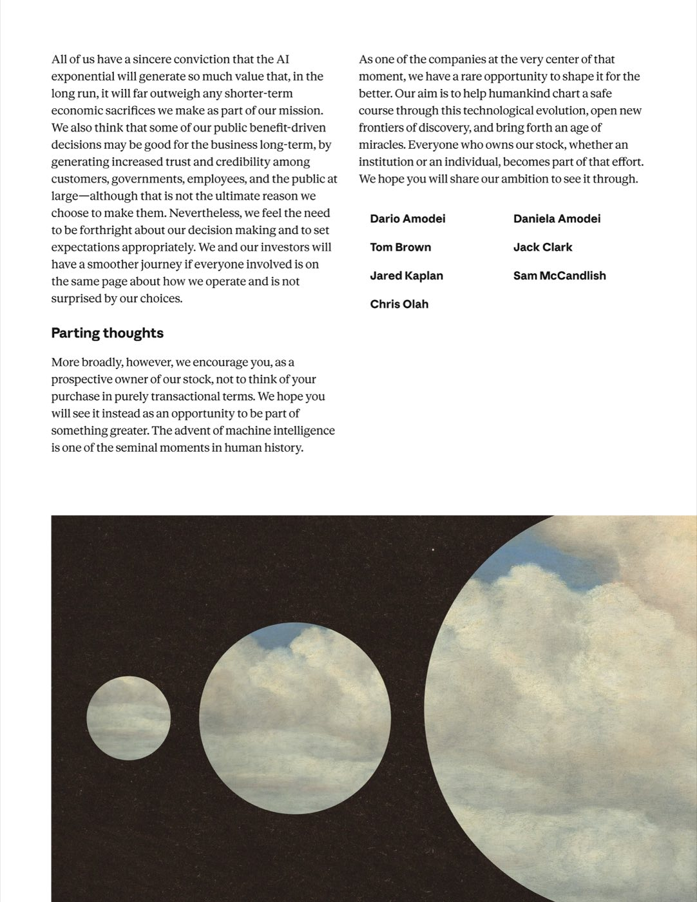

[SEC原圖](https://www.sec.gov/Archives/edgar/data/2130357/000162828026067168/a2026-10x25pg8a.jpg) · PDF實體頁10

信末邀請股東將持股視為參與技術發展與公共利益使命。署名為Dario Amodei、Daniela Amodei、Tom Brown、Jack Clark、Jared Kaplan、Sam McCandlish與Chris Olah。這是對投資人預期的說明，並非財務成果保證。

圖內標籤與重點：

- 短期經濟犧牲可能服務長期使命
- 信任可能有助長期業務，但不是使命決策的唯一理由
- 共同創辦人署名

## 10. 招股說明書概要

圖內標籤翻譯。

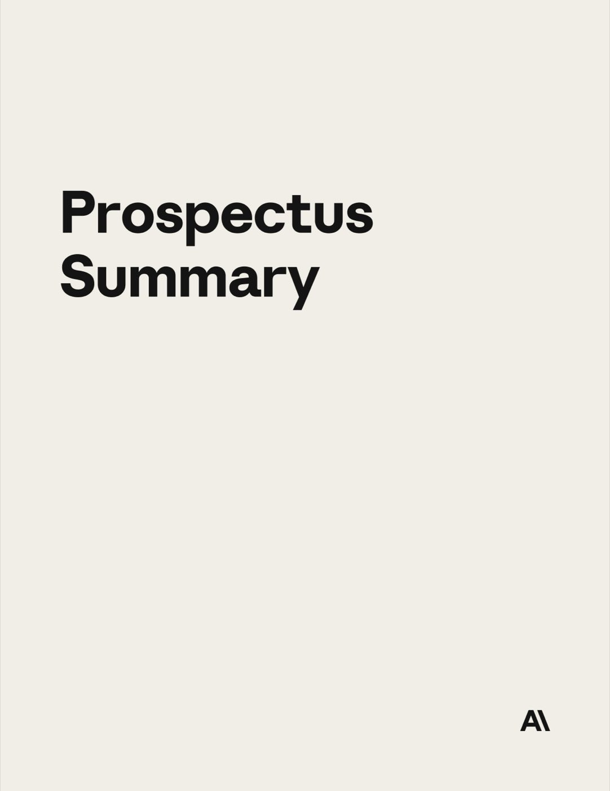

[SEC原圖](https://www.sec.gov/Archives/edgar/data/2130357/000162828026067168/a2026-10x24prospectusa.jpg) · PDF實體頁15

章節分頁，原文為Prospectus Summary。

圖內標籤與重點：

- 招股說明書概要

## 11. Claude的改善循環與投資循環

圖內標籤翻譯。

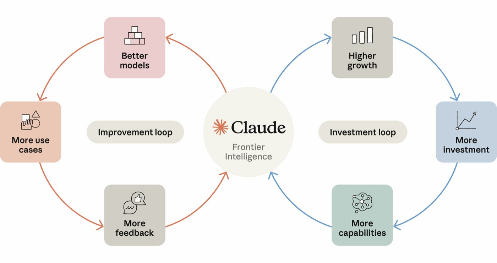

[SEC原圖](https://www.sec.gov/Archives/edgar/data/2130357/000162828026067168/business2a.jpg) · PDF實體頁22、194

左側循環：Claude促成更好的模型、更多使用情境及更多回饋，再回到Claude。右側循環：Claude帶動更高成長，支持更多投資及更多能力，再回到Claude。這是公司提出的正向循環，並非必然實現的因果保證。

圖內標籤與重點：

- Claude：前沿智慧
- 改善循環
- 更好的模型
- 更多使用情境
- 更多回饋
- 投資循環
- 更高成長
- 更多投資
- 更多能力

## 12. 風險因素

圖內標籤翻譯。

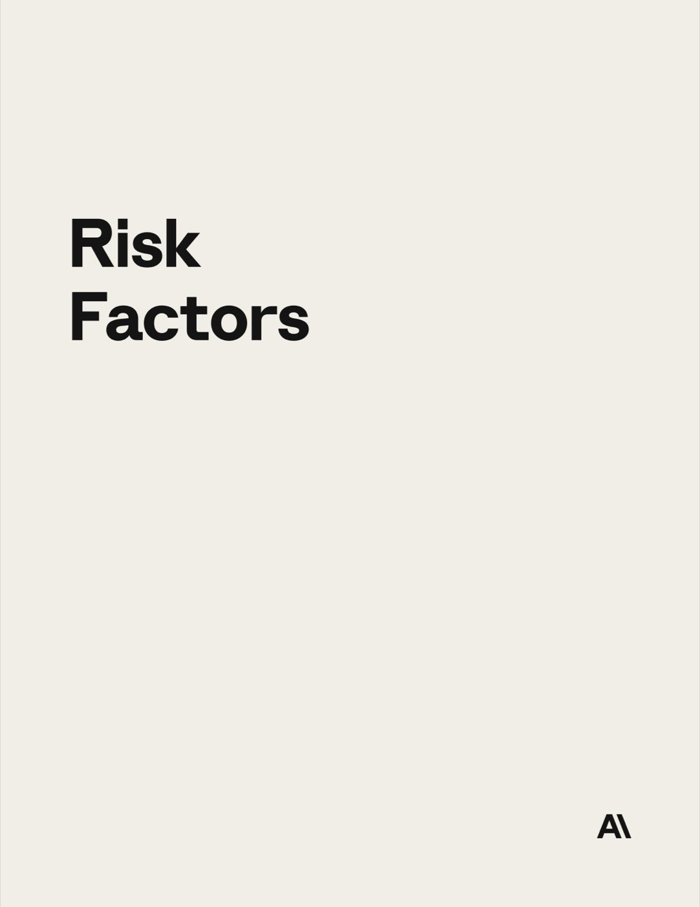

[SEC原圖](https://www.sec.gov/Archives/edgar/data/2130357/000162828026067168/a2026-10x24riska.jpg) · PDF實體頁37

章節分頁，原文為Risk Factors。

圖內標籤與重點：

- 風險因素

## 13. 管理階層討論與分析

圖內標籤翻譯。

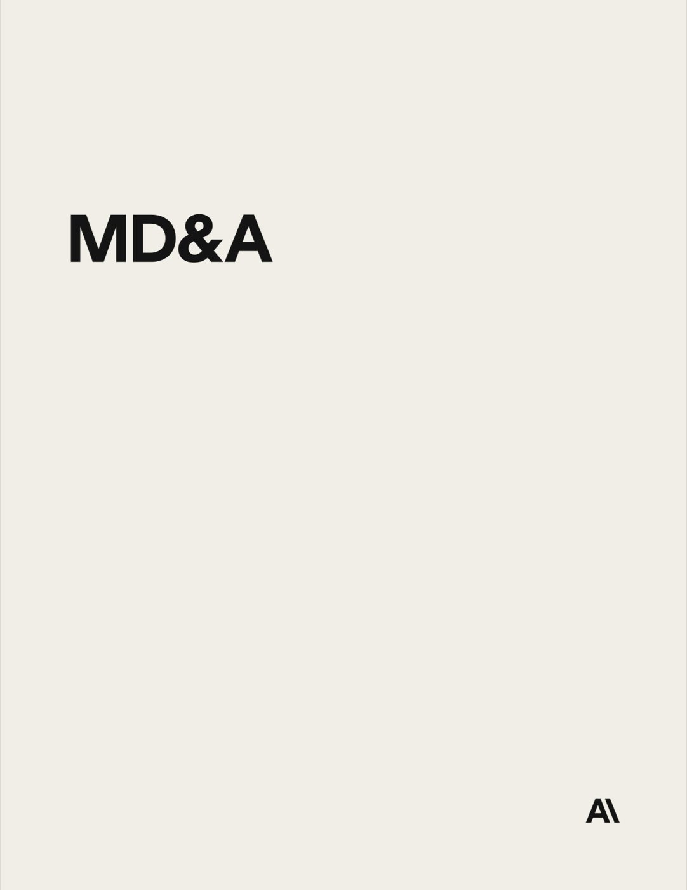

[SEC原圖](https://www.sec.gov/Archives/edgar/data/2130357/000162828026067168/a2026-10x24mdaa.jpg) · PDF實體頁143

章節分頁，MD&A為管理階層對財務狀況與營運結果的討論與分析。

圖內標籤與重點：

- 管理階層討論與分析

## 14. 企業客戶群快速成長

圖內標籤翻譯。

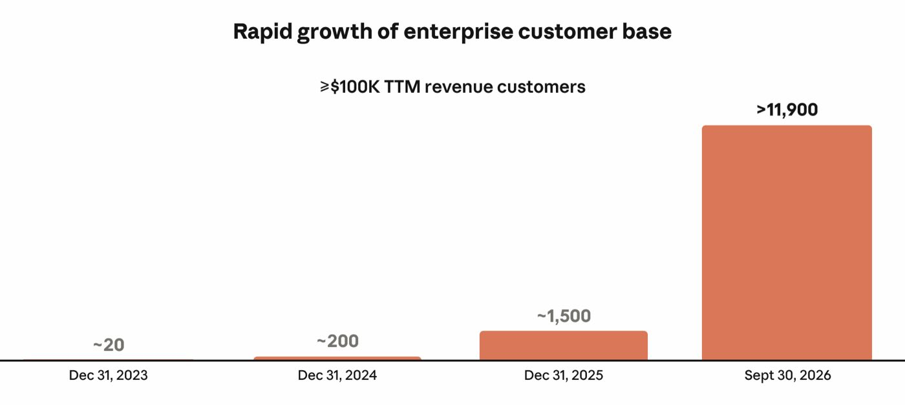

[SEC原圖](https://www.sec.gov/Archives/edgar/data/2130357/000162828026067168/mda2aa.jpg) · PDF實體頁145

口徑是近12個月對Anthropic貢獻營收至少10萬美元的組織客戶；門檻是實際收入貢獻，不是客戶員工人數或合約金額。

圖內標籤與重點：

- 近12個月營收貢獻至少10萬美元的客戶
- 2023-12-31：約20家
- 2024-12-31：約200家
- 2025-12-31：約1,500家
- 2026-09-30：超過11,900家

| 數值 | 原圖對應意義 |
|---|---|
| 約20 | 2023-12-31 |
| 約200 | 2024-12-31 |
| 約1,500 | 2025-12-31 |
| 超過11,900 | 2026-09-30 |

## 15. 每美元算力支出對應營收明顯提高

圖內標籤翻譯。

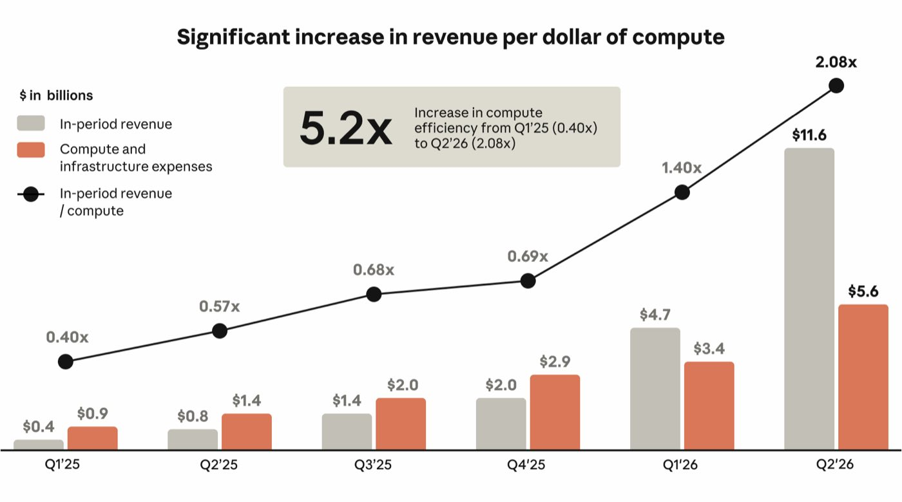

[SEC原圖](https://www.sec.gov/Archives/edgar/data/2130357/000162828026067168/mda3aa.jpg) · PDF實體頁147

圖中的比率分母是算力與基礎設施費用，包含支援研發、模型開發、客戶需求與內部Claude使用的投入；不是毛利率，也不是資本支出報酬率。圖示金額經四捨五入，不宜用圖上小數反推精確會計數字。

圖內標籤與重點：

- 單位：十億美元
- 當季營收
- 算力與基礎設施費用
- 當季營收／算力與基礎設施費用
- 2025年第1季至2026年第2季：0.40倍升至2.08倍，為5.2倍

| 數值 | 原圖對應意義 |
|---|---|
| 2025Q1 | 營收0.4／費用0.9／比率0.40倍 |
| 2025Q2 | 營收0.8／費用1.4／比率0.57倍 |
| 2025Q3 | 營收1.4／費用2.0／比率0.68倍 |
| 2025Q4 | 營收2.0／費用2.9／比率0.69倍 |
| 2026Q1 | 營收4.7／費用3.4／比率1.40倍 |
| 2026Q2 | 營收11.6／費用5.6／比率2.08倍 |

## 16. 營運效率帶動調整後營業利益率改善

圖內標籤翻譯。

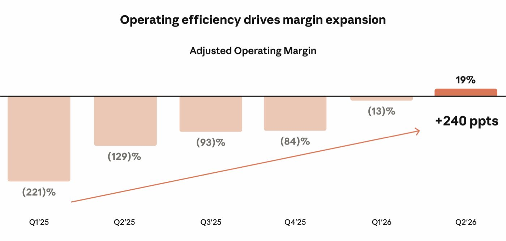

[SEC原圖](https://www.sec.gov/Archives/edgar/data/2130357/000162828026067168/mda4aa.jpg) · PDF實體頁148

這是公司定義的非GAAP調整後營業利益率。2026年第2季為19%；判讀時須另看GAAP營業損益、淨損與兩種口徑的調節表，不能把這張圖直接當作淨利率。

圖內標籤與重點：

- 調整後營業利益率
- 2025Q1：−221%
- 2025Q2：−129%
- 2025Q3：−93%
- 2025Q4：−84%
- 2026Q1：−13%
- 2026Q2：19%
- 改善240個百分點

| 數值 | 原圖對應意義 |
|---|---|
| −221% | 2025Q1 |
| −129% | 2025Q2 |
| −93% | 2025Q3 |
| −84% | 2025Q4 |
| −13% | 2026Q1 |
| 19% | 2026Q2 |

## 17. 業務

圖內標籤翻譯。

[SEC原圖](https://www.sec.gov/Archives/edgar/data/2130357/000162828026067168/a2026-10x24businessa.jpg) · PDF實體頁189

章節分頁，原文為Business。

圖內標籤與重點：

- 業務

## 18. 核心優勢、企業採用與財務模式的連結

圖內標籤翻譯。

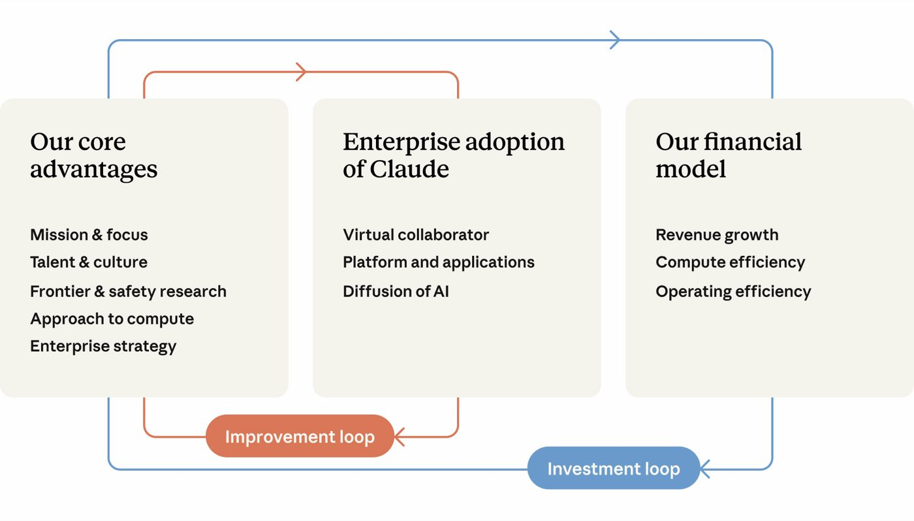

[SEC原圖](https://www.sec.gov/Archives/edgar/data/2130357/000162828026067168/a2026-09x27xgraphicsxcompe.jpg) · PDF實體頁190

原圖以三組模組連接公司能力、企業採用及財務模式，再用改善循環與投資循環回饋到核心優勢。此圖是管理階層的商業邏輯陳述。

圖內標籤與重點：

- 核心優勢：使命與專注、人才與文化、前沿與安全研究、算力策略、企業策略
- 企業採用Claude：虛擬協作者、平台與應用、AI擴散
- 財務模式：營收成長、算力效率、營運效率
- 改善循環
- 投資循環

## 19. 從聊天機器人到虛擬協作者

圖內標籤翻譯。

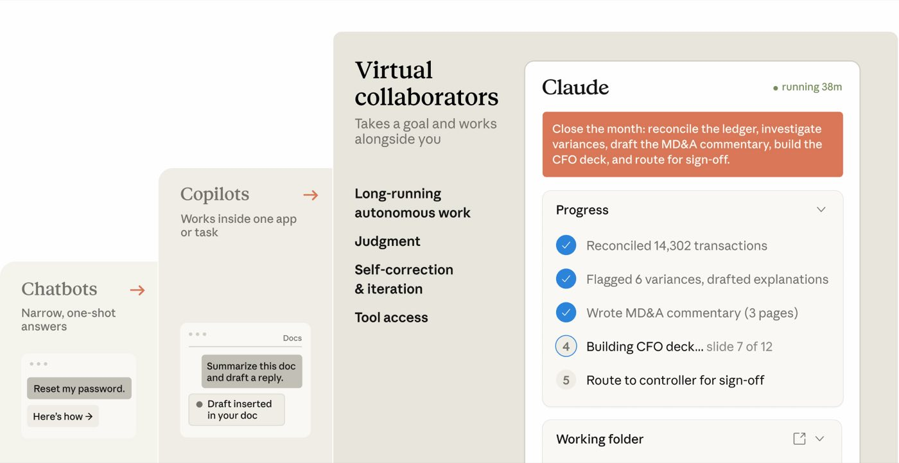

[SEC原圖](https://www.sec.gov/Archives/edgar/data/2130357/000162828026067168/business4a.jpg) · PDF實體頁201

原圖是概念性產品情境展示；14,302筆交易、38分鐘等是畫面示例，不是經稽核的客戶效益數據。

圖內標籤與重點：

- 聊天機器人：範圍較窄、單次回答
- 重設我的密碼 → 操作方式如下
- 副駕駛：在單一應用或任務內工作
- 摘要這份文件並草擬回覆 → 草稿已插入文件
- 虛擬協作者：接收目標，與你協作
- 長時間自主工作
- 判斷能力
- 自我修正與反覆改進
- 工具存取權
- 運行中：38分鐘
- 任務：完成月結，核對總帳、調查差異、撰寫MD&A說明、製作財務長簡報並送簽
- 進度：已核對14,302筆交易；已標出6項差異並草擬說明；已撰寫3頁MD&A說明；正在製作12頁簡報的第7頁；後續送財務主管簽核
- 工作資料夾

## 20. Claude的客戶價值、平台與模型

圖內標籤翻譯。

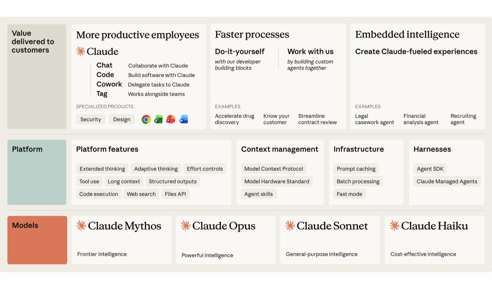

[SEC原圖](https://www.sec.gov/Archives/edgar/data/2130357/000162828026067168/business5b.jpg) · PDF實體頁210

原圖將Claude分成三層：上層是提升員工生產力、加速流程與嵌入式智慧等客戶價值；中層提供工具、上下文管理、基礎設施與代理執行能力；底層是不同能力與成本取向的模型。這些層次相互支援，企業可使用現成應用，也可自行打造產品。

圖內標籤與重點：

- 客戶價值
- 提升員工生產力
- Chat：與Claude協作
- Code：與Claude一起開發軟體
- Cowork：將任務交給Claude
- Tag：與團隊協作
- 專用產品：安全、設計；瀏覽器與辦公軟體整合
- 加速流程
- 自行建置：使用開發元件
- 與公司合作：共同打造客製代理
- 情境示例：加速藥物探索、認識你的客戶、簡化合約審查
- 嵌入式智慧：打造由Claude驅動的體驗
- 情境示例：法律案件代理、財務分析代理、招募代理
- 平台功能：延伸思考、自適應思考、推理投入控制、工具使用、長上下文、結構化輸出、程式碼執行、網頁搜尋、檔案API
- 上下文管理：模型上下文協定、模型硬體標準、代理技能
- 基礎設施：提示快取、批次處理、快速模式
- 代理執行框架：代理SDK、Claude代管代理
- 模型：Claude Mythos—前沿智慧；Claude Opus—強大智慧；Claude Sonnet—通用智慧；Claude Haiku—具成本效益的智慧

## 21. 推動專業服務轉型

摘要譯讀／圖內指標翻譯。

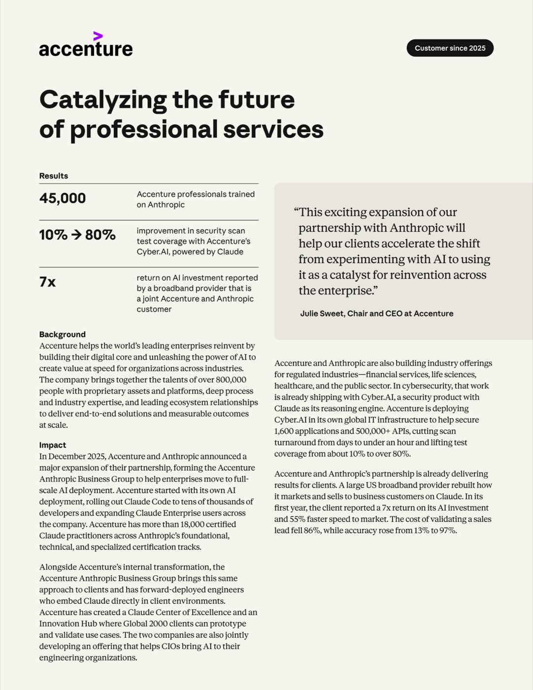

[SEC原圖](https://www.sec.gov/Archives/edgar/data/2130357/000162828026067168/a2026-10x25xcasestudyxaccea.jpg) · PDF實體頁219

Accenture將Claude導入自身及客戶工作流程，結合前線部署工程師、產業知識與企業治理。圖中7倍報酬屬單一共同客戶回報；不能套用至所有客戶。

圖內標籤與重點：

- 45,000：接受Anthropic相關訓練的專業人員
- 10%→80%：Cyber.AI安全掃描測試涵蓋率
- 7倍：一家共同寬頻客戶自報的AI投資報酬

| 數值 | 原圖對應意義 |
|---|---|
| 45,000 | 接受Anthropic相關訓練的專業人員 |
| 10%→80% | Cyber.AI安全掃描測試涵蓋率 |
| 7倍 | 一家共同寬頻客戶自報的AI投資報酬 |

原圖標示：自2025年成為客戶。

申報文件選定客戶案例／公司或客戶自報，非獨立因果驗證。

## 22. 重新設計商業保險核保

摘要譯讀／圖內指標翻譯。

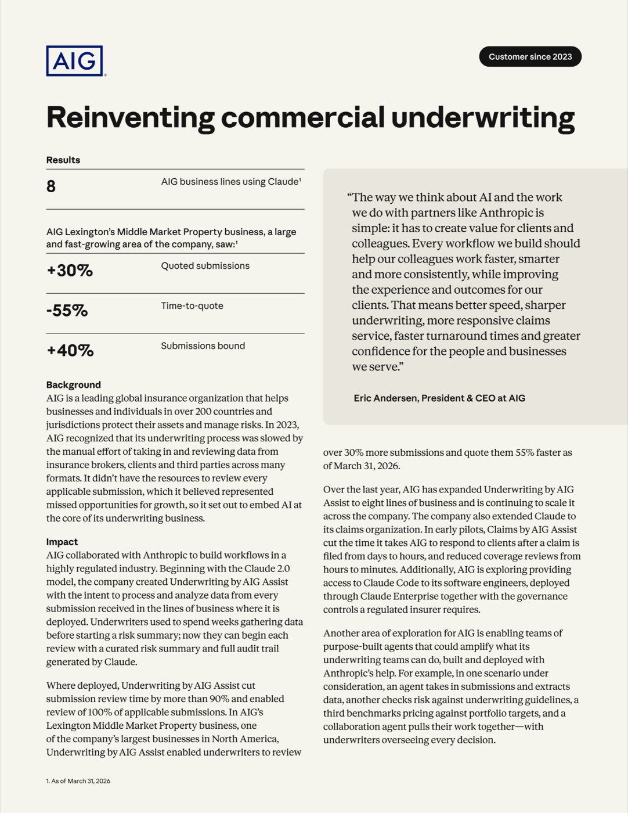

[SEC原圖](https://www.sec.gov/Archives/edgar/data/2130357/000162828026067168/casestudy-aig1da.jpg) · PDF實體頁220

Claude協助整理核保資料、產生風險摘要與稽核軌跡。後三項成果屬AIG Lexington中型市場財產險業務，資料截至2026-03-31，不能推廣為AIG全公司平均。

圖內標籤與重點：

- 8：採用Claude的業務線
- +30%：完成報價的投保申請件數
- −55%：報價所需時間
- +40%：完成承保的投保申請件數

| 數值 | 原圖對應意義 |
|---|---|
| 8 | 採用Claude的業務線 |
| +30% | 完成報價的投保申請件數 |
| −55% | 報價所需時間 |
| +40% | 完成承保的投保申請件數 |

原圖標示：自2023年成為客戶。

申報文件選定客戶案例／公司或客戶自報，非獨立因果驗證。

## 23. 加快新藥探索

摘要譯讀／圖內指標翻譯。

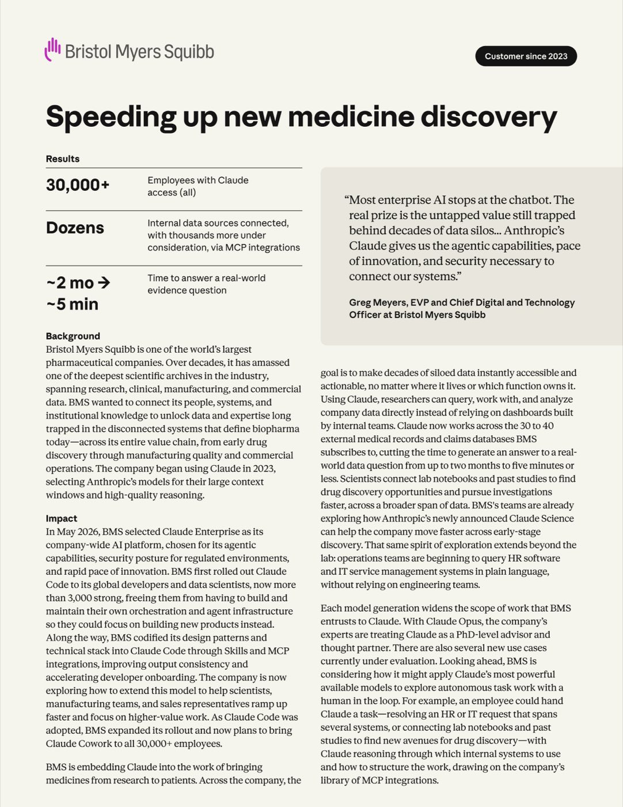

[SEC原圖](https://www.sec.gov/Archives/edgar/data/2130357/000162828026067168/casestudiesbristol3da.jpg) · PDF實體頁221

公司將研究、臨床、製造及商業資料接入Claude，先導入開發者，再擴及知識工作；約5分鐘指特定資料問答流程，不是整體新藥開發時間。

圖內標籤與重點：

- 30,000+：有Claude使用權的員工
- 數十個：經MCP連結的內部資料來源；另有數千個來源考慮串接
- 約2個月→約5分鐘：回答真實世界證據問題所需時間

| 數值 | 原圖對應意義 |
|---|---|
| 30,000+ | 有Claude使用權的員工 |
| 數十個 | 經MCP連結的內部資料來源 |
| 約2個月→約5分鐘 | 回答真實世界證據問題所需時間 |

申報文件選定客戶案例／公司或客戶自報，非獨立因果驗證。

## 24. 從寫程式到知識工作支援每位員工

摘要譯讀／圖內指標翻譯。

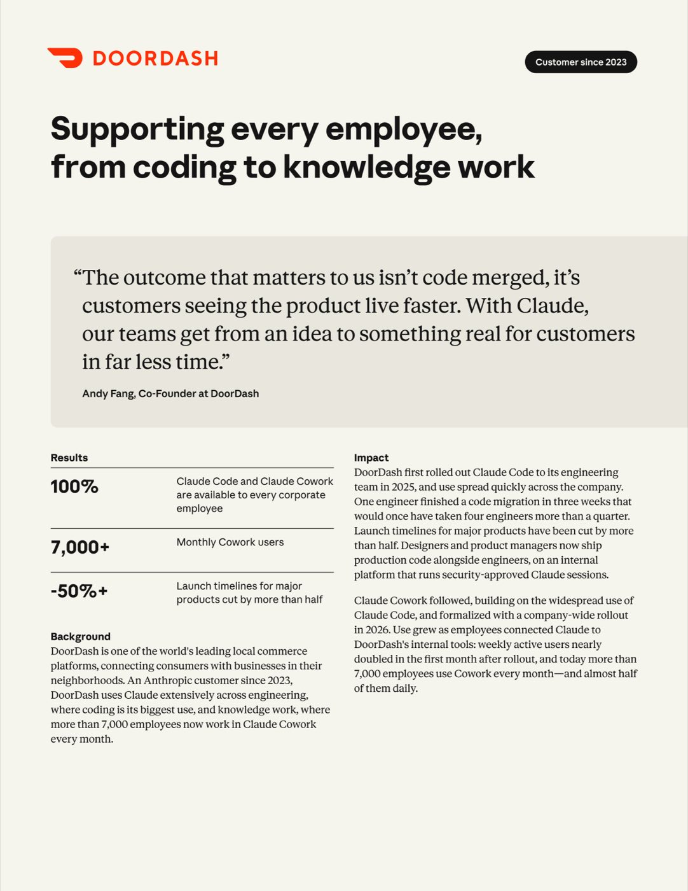

[SEC原圖](https://www.sec.gov/Archives/edgar/data/2130357/000162828026067168/casestudy-doordash1c.jpg) · PDF實體頁222

Claude Code先由工程部門擴散，再導入Cowork與內部工具。產品時程改善屬案例陳述，未提供統一實驗方法或全產品平均。

圖內標籤與重點：

- 100%：公司職員可使用Claude Code與Cowork
- 7,000+：Cowork每月使用者
- 縮短逾50%：主要產品上線時程

| 數值 | 原圖對應意義 |
|---|---|
| 100% | 公司職員可使用Claude Code與Cowork |
| 7,000+ | Cowork每月使用者 |
| 縮短逾50% | 主要產品上線時程 |

原圖標示：自2023年成為客戶。

申報文件選定客戶案例／公司或客戶自報，非獨立因果驗證。

## 25. 用前沿AI支援第一線人道救援

摘要譯讀／圖內指標翻譯。

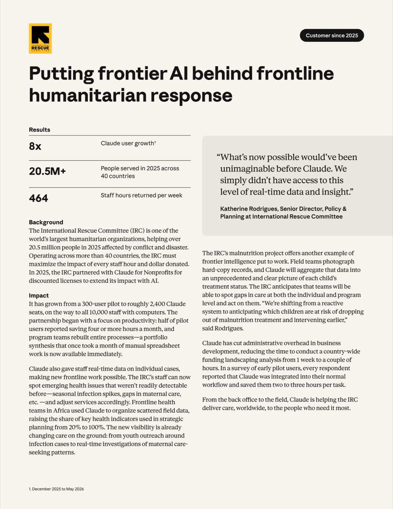

[SEC原圖](https://www.sec.gov/Archives/edgar/data/2130357/000162828026067168/casestudy-internationalres.jpg) · PDF實體頁223

IRC由300人試點成長至約2,400席，應用在資料整理、營養不良照護及募資分析。2,050萬是組織服務規模，不是Claude新增服務人數。

圖內標籤與重點：

- 8倍：Claude使用者成長，2025-12至2026-05
- 2,050萬+：IRC於2025年跨40國服務人數
- 464小時：每週節省的員工工時

| 數值 | 原圖對應意義 |
|---|---|
| 8倍 | Claude使用者成長，2025-12至2026-05 |
| 2,050萬+ | IRC於2025年跨40國服務人數 |
| 464小時 | 每週節省的員工工時 |

原圖標示：自2025年成為客戶。

申報文件選定客戶案例／公司或客戶自報，非獨立因果驗證。

## 26. 交易公司可託付的前沿智慧

摘要譯讀／圖內指標翻譯。

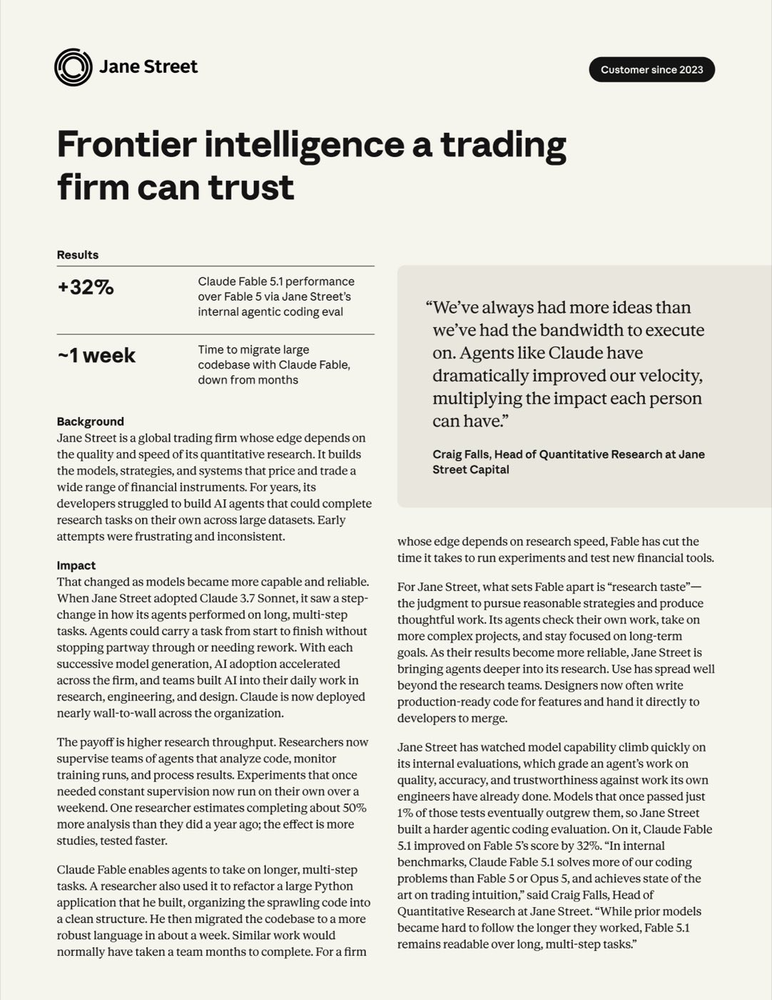

[SEC原圖](https://www.sec.gov/Archives/edgar/data/2130357/000162828026067168/casestudy-janestreet1da.jpg) · PDF實體頁224

Claude協助研究、程式分析與長時間多步驟任務。32%來自Jane Street內部評測；遷移時間屬特定案例，不代表所有交易模型或策略績效。

圖內標籤與重點：

- +32%：Fable 5.1相對Fable 5在內部代理程式評測的表現
- 約1週：大型程式碼庫遷移時間，原需數月

| 數值 | 原圖對應意義 |
|---|---|
| +32% | Fable 5.1相對Fable 5在內部代理程式評測的表現 |
| 約1週 | 大型程式碼庫遷移時間，原需數月 |

原圖標示：自2023年成為客戶。

申報文件選定客戶案例／公司或客戶自報，非獨立因果驗證。

## 27. 擴展律師的代理工作系統

摘要譯讀／圖內指標翻譯。

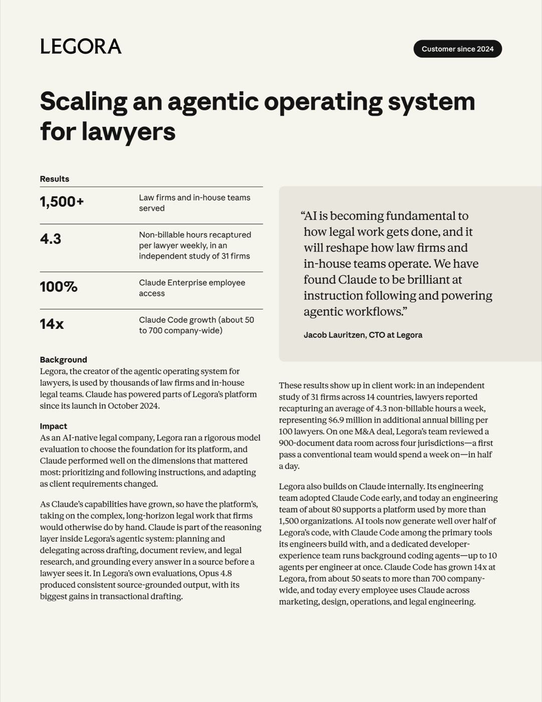

[SEC原圖](https://www.sec.gov/Archives/edgar/data/2130357/000162828026067168/casestudy-legora1ca.jpg) · PDF實體頁225

Legora將Claude作為法律代理系統的推理層。4.3小時來自31家事務所的研究；原圖所述收入潛力仍依使用情境及計費轉換而定。

圖內標籤與重點：

- 1,500+：服務的律所與企業法務團隊
- 4.3小時：每位律師每週收回的非計費工時
- 100%：員工可使用Claude Enterprise
- 14倍：Claude Code席次由約50增至約700

| 數值 | 原圖對應意義 |
|---|---|
| 1,500+ | 服務的律所與企業法務團隊 |
| 4.3小時 | 每位律師每週收回的非計費工時 |
| 100% | 員工可使用Claude Enterprise |
| 14倍 | Claude Code席次由約50增至約700 |

原圖標示：自2024年成為客戶。

申報文件選定客戶案例／公司或客戶自報，非獨立因果驗證。

## 28. 讓科學工具進入每個團隊

摘要譯讀／圖內指標翻譯。

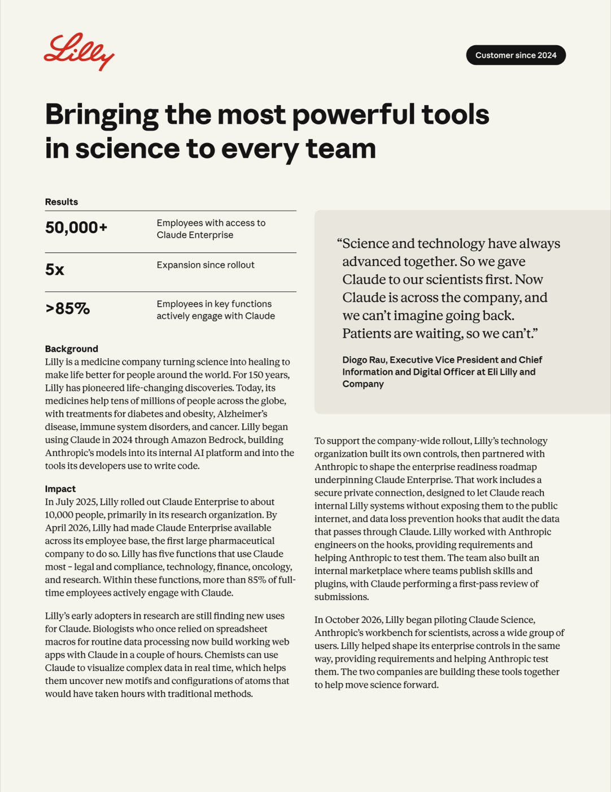

[SEC原圖](https://www.sec.gov/Archives/edgar/data/2130357/000162828026067168/casestudy-lilly1ba.jpg) · PDF實體頁226

Lilly先從研究人員導入，再擴及法務、技術、財務、腫瘤與研究等職能，並共同設計私有連線與資料外洩防護。85%限於案例指定關鍵職能。

圖內標籤與重點：

- 50,000+：可使用Claude Enterprise的員工
- 5倍：推廣後使用權覆蓋規模增幅
- 超過85%：關鍵職能員工積極使用Claude

| 數值 | 原圖對應意義 |
|---|---|
| 50,000+ | 可使用Claude Enterprise的員工 |
| 5倍 | 推廣後使用權覆蓋規模增幅 |
| 超過85% | 關鍵職能員工積極使用Claude |

申報文件選定客戶案例／公司或客戶自報，非獨立因果驗證。

## 29. 改變拉丁美洲電子商務

摘要譯讀／圖內指標翻譯。

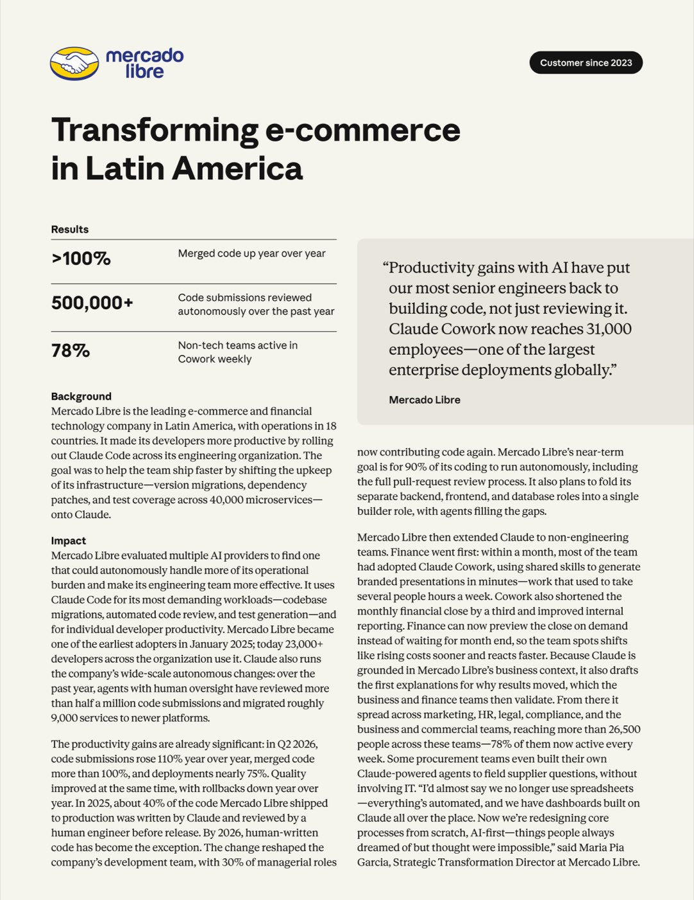

[SEC原圖](https://www.sec.gov/Archives/edgar/data/2130357/000162828026067168/casestudy-mercadolibrex21da.jpg) · PDF實體頁227

Claude從程式遷移、審查與測試擴展到財務月結及非技術工作。圖中文字顯示自主審查仍有人類監督，不能理解成完全免人工審核。

圖內標籤與重點：

- 超過100%：合併程式碼量年增
- 500,000+：過去一年由代理自主審查的程式提交
- 78%：每週活躍使用Cowork的非技術團隊比例

| 數值 | 原圖對應意義 |
|---|---|
| 超過100% | 合併程式碼量年增 |
| 500,000+ | 過去一年由代理自主審查的程式提交 |
| 78% | 每週活躍使用Cowork的非技術團隊比例 |

原圖標示：自2023年成為客戶。

申報文件選定客戶案例／公司或客戶自報，非獨立因果驗證。

## 30. 找出攻擊者尚未發現的漏洞

摘要譯讀／圖內指標翻譯。

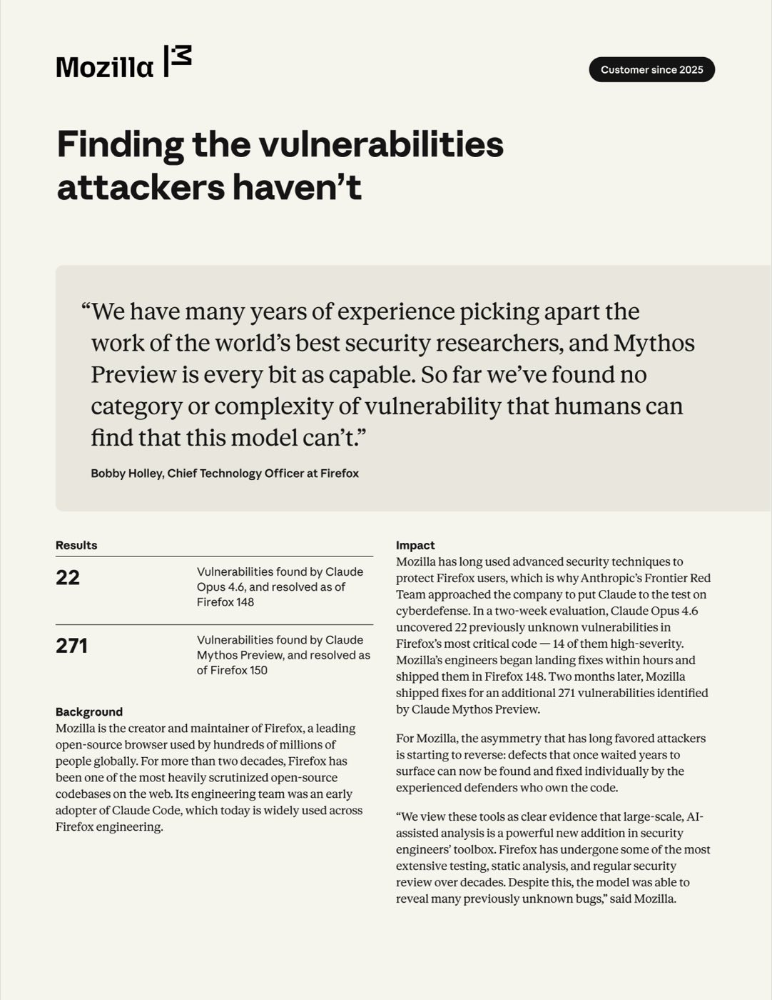

[SEC原圖](https://www.sec.gov/Archives/edgar/data/2130357/000162828026067168/casestudy-mozilla1da.jpg) · PDF實體頁228

Mozilla使用Claude協助搜尋Firefox漏洞，並由工程師修復。這是不同評測階段與版本的案例數量，不能直接拿來計算一般性模型準確率。

圖內標籤與重點：

- 22：Opus 4.6找到、於Firefox 148修復的漏洞
- 271：Mythos Preview找到、於Firefox 150修復的漏洞

| 數值 | 原圖對應意義 |
|---|---|
| 22 | Opus 4.6找到、於Firefox 148修復的漏洞 |
| 271 | Mythos Preview找到、於Firefox 150修復的漏洞 |

原圖標示：自2025年成為客戶。

申報文件選定客戶案例／公司或客戶自報，非獨立因果驗證。

## 31. 將AI擴展至逾1.2萬名員工

摘要譯讀／圖內指標翻譯。

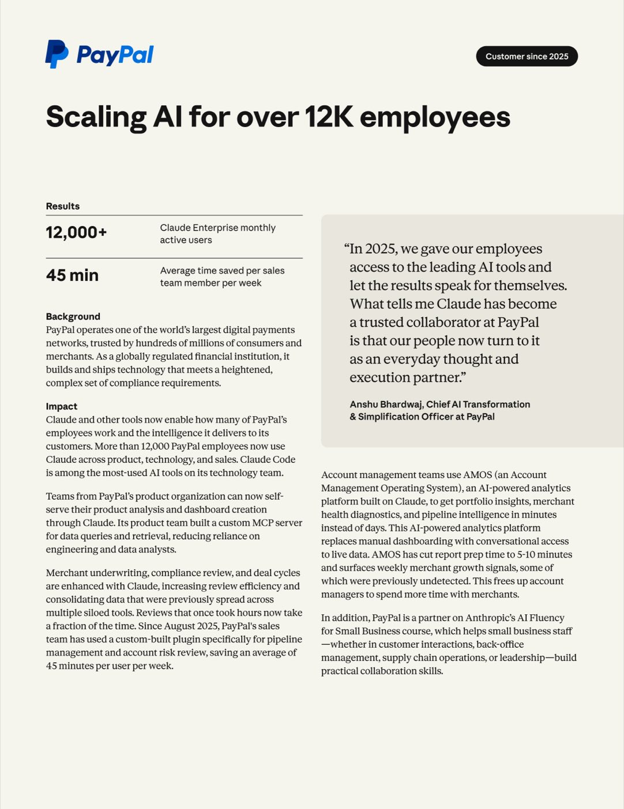

[SEC原圖](https://www.sec.gov/Archives/edgar/data/2130357/000162828026067168/casestudy-paypal1da.jpg) · PDF實體頁229

PayPal將Claude用於產品分析、商戶審查及帳戶管理資料分析，以MCP串接資料。45分鐘屬銷售團隊的特定外掛工作流程。

圖內標籤與重點：

- 12,000+：Claude Enterprise每月活躍使用者
- 45分鐘：銷售團隊成員平均每週節省時間

| 數值 | 原圖對應意義 |
|---|---|
| 12,000+ | Claude Enterprise每月活躍使用者 |
| 45分鐘 | 銷售團隊成員平均每週節省時間 |

申報文件選定客戶案例／公司或客戶自報，非獨立因果驗證。

## 32. 讓每位員工都能打造工具

摘要譯讀／圖內指標翻譯。

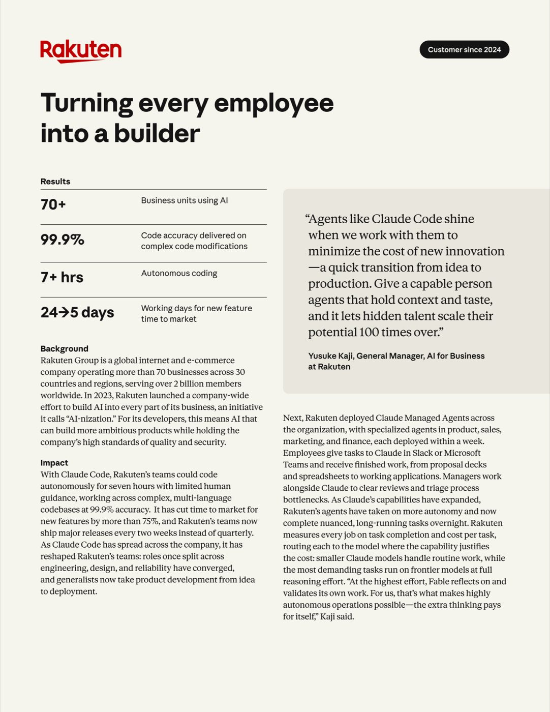

[SEC原圖](https://www.sec.gov/Archives/edgar/data/2130357/000162828026067168/casestudy-rakuten1ba.jpg) · PDF實體頁230

Rakuten將代理導入開發與各業務團隊，依任務成本與能力選擇模型。99.9%屬案例陳述，未提供可推廣至所有任務的標準化測試。

圖內標籤與重點：

- 70+：使用AI的業務單位
- 99.9%：複雜程式修改案例的程式正確率
- 超過7小時：自主編碼時間
- 24→5個工作天：新功能上市時間

| 數值 | 原圖對應意義 |
|---|---|
| 70+ | 使用AI的業務單位 |
| 99.9% | 複雜程式修改案例的程式正確率 |
| 超過7小時 | 自主編碼時間 |
| 24→5個工作天 | 新功能上市時間 |

原圖標示：自2024年成為客戶。

申報文件選定客戶案例／公司或客戶自報，非獨立因果驗證。

## 33. 重新設計全球企業的建造方式

摘要譯讀／圖內指標翻譯。

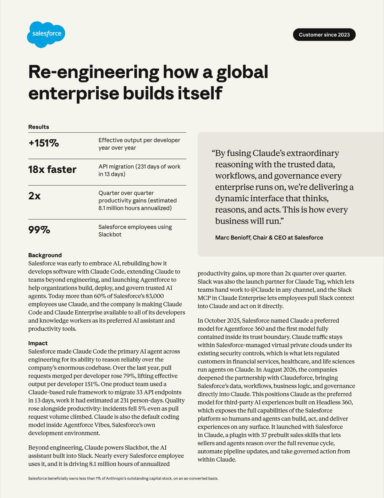

[SEC原圖](https://www.sec.gov/Archives/edgar/data/2130357/000162828026067168/casestudy-salesforce1b.jpg) · PDF實體頁231

Claude用於程式開發、Slackbot及Agentforce等產品整合。人日與日曆天口徑不同，原圖18倍應視為公司案例說法。

圖內標籤與重點：

- +151%：每位開發者有效產出年增
- 約18倍：API遷移加速：231人日的估計工作於13天完成
- 超過2倍：生產力效益季增；估計年化810萬小時
- 99%：使用Slackbot的Salesforce員工

| 數值 | 原圖對應意義 |
|---|---|
| +151% | 每位開發者有效產出年增 |
| 約18倍 | API遷移加速：231人日的估計工作於13天完成 |
| 超過2倍 | 生產力效益季增；估計年化810萬小時 |
| 99% | 使用Slackbot的Salesforce員工 |

原圖標示：自2023年成為客戶。

申報文件選定客戶案例／公司或客戶自報，非獨立因果驗證。

補充：Salesforce以轉換後口徑持有Anthropic不到1%的已發行股本。

## 34. 將前沿智慧嵌入全球商務系統

摘要譯讀／圖內指標翻譯。

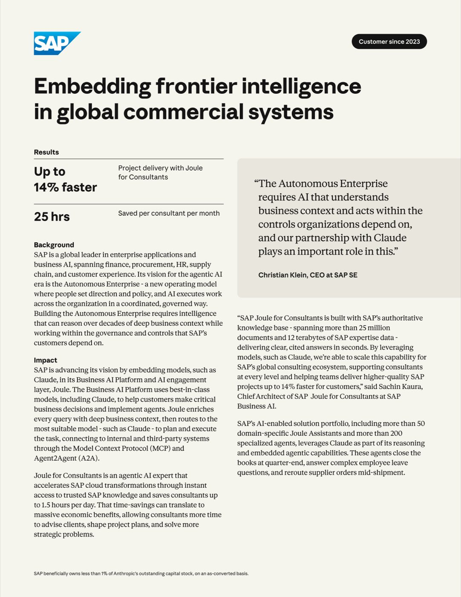

[SEC原圖](https://www.sec.gov/Archives/edgar/data/2130357/000162828026067168/casestudy-sap1c.jpg) · PDF實體頁232

SAP將Claude等模型嵌入Business AI Platform與Joule，利用企業上下文及既有控制協助規劃與執行；圖中25小時與最多14%為指定產品案例。

圖內標籤與重點：

- 最多快14%：Joule for Consultants協助的專案交付
- 25小時：每位顧問每月節省時間

| 數值 | 原圖對應意義 |
|---|---|
| 最多快14% | Joule for Consultants協助的專案交付 |
| 25小時 | 每位顧問每月節省時間 |

申報文件選定客戶案例／公司或客戶自報，非獨立因果驗證。

補充：SAP以轉換後口徑持有Anthropic不到1%的已發行股本。

## 35. 用Claude為數百萬商家提供AI能力

摘要譯讀／圖內指標翻譯。

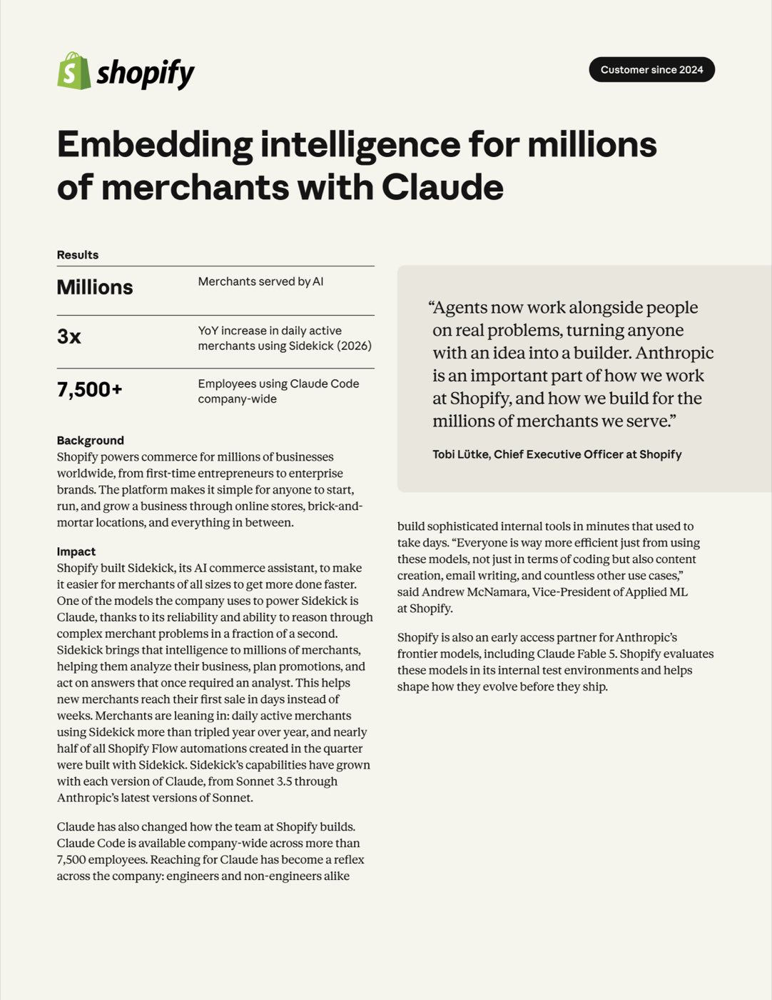

[SEC原圖](https://www.sec.gov/Archives/edgar/data/2130357/000162828026067168/casestudy-shopify1ca.jpg) · PDF實體頁233

Claude是Sidekick使用的模型之一，協助商家分析與工作流程；不能將Sidekick全部成果歸因單一模型。

圖內標籤與重點：

- 數百萬：AI服務的商家規模
- 3倍：2026年Sidekick每日活躍商家年增倍數
- 7,500+：公司內使用Claude Code的員工

| 數值 | 原圖對應意義 |
|---|---|
| 數百萬 | AI服務的商家規模 |
| 3倍 | 2026年Sidekick每日活躍商家年增倍數 |
| 7,500+ | 公司內使用Claude Code的員工 |

原圖標示：自2024年成為客戶。

申報文件選定客戶案例／公司或客戶自報，非獨立因果驗證。

## 36. 以AI深化風險專業

摘要譯讀／圖內指標翻譯。

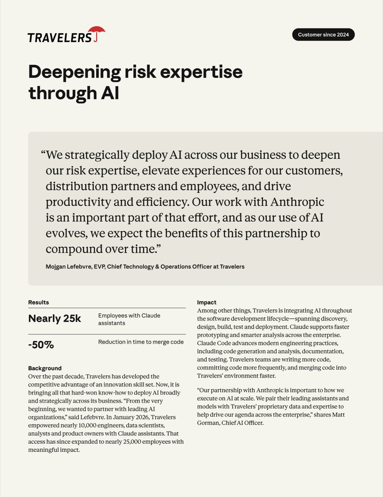

[SEC原圖](https://www.sec.gov/Archives/edgar/data/2130357/000162828026067168/casestudy-travelers1ca.jpg) · PDF實體頁234

公司把Claude導入軟體開發生命週期及分析工作，結合自有資料、專業知識與治理。員工數是取得使用權的人數，不是每月活躍數。

圖內標籤與重點：

- 近25,000：可使用Claude助理的員工
- −50%：合併程式碼所需時間

| 數值 | 原圖對應意義 |
|---|---|
| 近25,000 | 可使用Claude助理的員工 |
| −50% | 合併程式碼所需時間 |

原圖標示：自2024年成為客戶。

申報文件選定客戶案例／公司或客戶自報，非獨立因果驗證。

## 37. 強化全球基礎設施的根基

摘要譯讀／圖內指標翻譯。

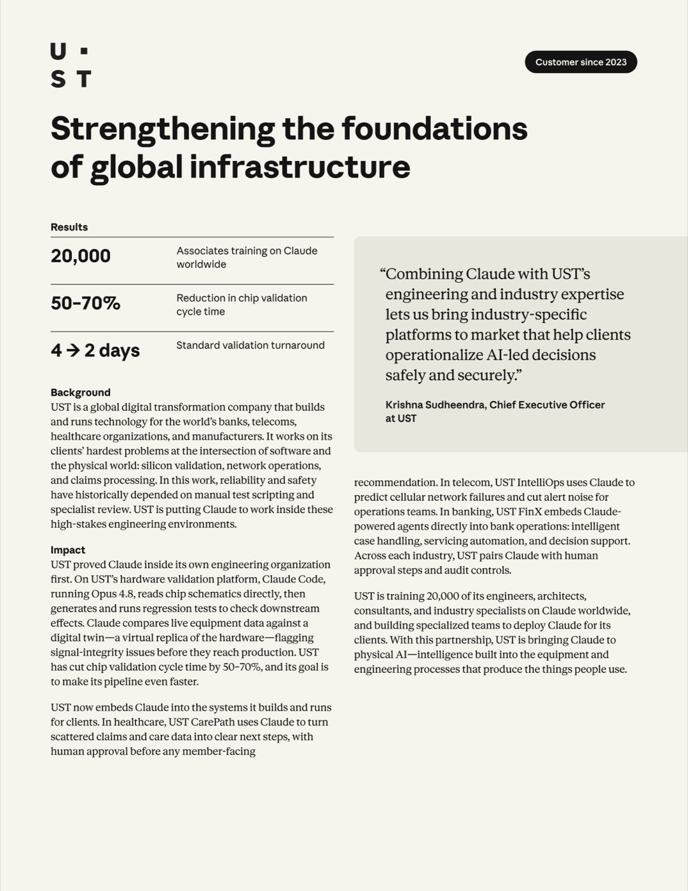

[SEC原圖](https://www.sec.gov/Archives/edgar/data/2130357/000162828026067168/casestudy-ust1ca.jpg) · PDF實體頁235

UST以Claude Code讀取晶片電路圖、執行回歸測試並比對數位分身，也用於電信與銀行；流程仍搭配人類核准與稽核控制。

圖內標籤與重點：

- 20,000：接受Claude訓練的全球員工
- 縮短50%–70%：晶片驗證週期
- 4天→2天：標準驗證周轉時間

| 數值 | 原圖對應意義 |
|---|---|
| 20,000 | 接受Claude訓練的全球員工 |
| 縮短50%–70% | 晶片驗證週期 |
| 4天→2天 | 標準驗證周轉時間 |

原圖標示：自2023年成為客戶。

申報文件選定客戶案例／公司或客戶自報，非獨立因果驗證。

## 38. 重建並保護大型通訊網路

摘要譯讀／圖內指標翻譯。

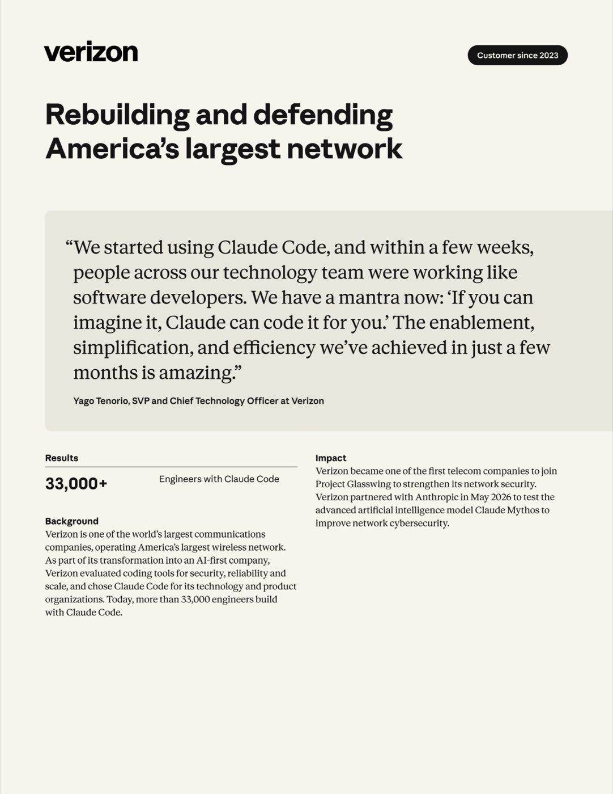

[SEC原圖](https://www.sec.gov/Archives/edgar/data/2130357/000162828026067168/casestudy-verizon1da.jpg) · PDF實體頁236

Verizon將Claude Code導入技術與產品組織，並參加Project Glasswing測試Mythos用於網路安全。工程師使用規模不等同已證明的成本節省。

圖內標籤與重點：

- 33,000+：使用Claude Code的工程師

| 數值 | 原圖對應意義 |
|---|---|
| 33,000+ | 使用Claude Code的工程師 |

申報文件選定客戶案例／公司或客戶自報，非獨立因果驗證。

## 39. 讓購物更快速、便利且個人化

摘要譯讀／圖內指標翻譯。

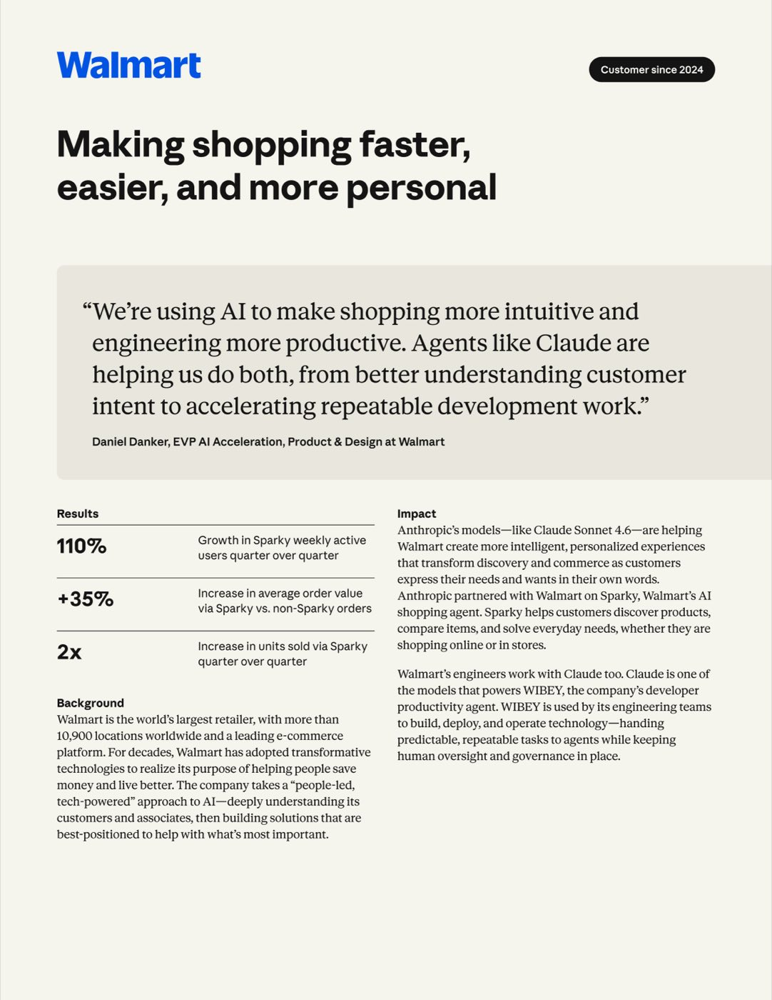

[SEC原圖](https://www.sec.gov/Archives/edgar/data/2130357/000162828026067168/casestudy-walmart1ca.jpg) · PDF實體頁237

Claude Sonnet 4.6等模型支援Sparky購物代理，Claude亦支援內部WIBEY開發工具。35%是兩群訂單的觀察差異，不能單憑此圖證明AI造成全部增幅。

圖內標籤與重點：

- +110%：Sparky每週活躍使用者季增
- +35%：Sparky訂單相對非Sparky訂單的平均金額差異
- 2倍：透過Sparky售出商品件數季增

| 數值 | 原圖對應意義 |
|---|---|
| +110% | Sparky每週活躍使用者季增 |
| +35% | Sparky訂單相對非Sparky訂單的平均金額差異 |
| 2倍 | 透過Sparky售出商品件數季增 |

原圖標示：自2024年成為客戶。

申報文件選定客戶案例／公司或客戶自報，非獨立因果驗證。

## 40. 小型企業：Shy Bird與KBF Design Gallery

摘要譯讀／圖內指標翻譯。

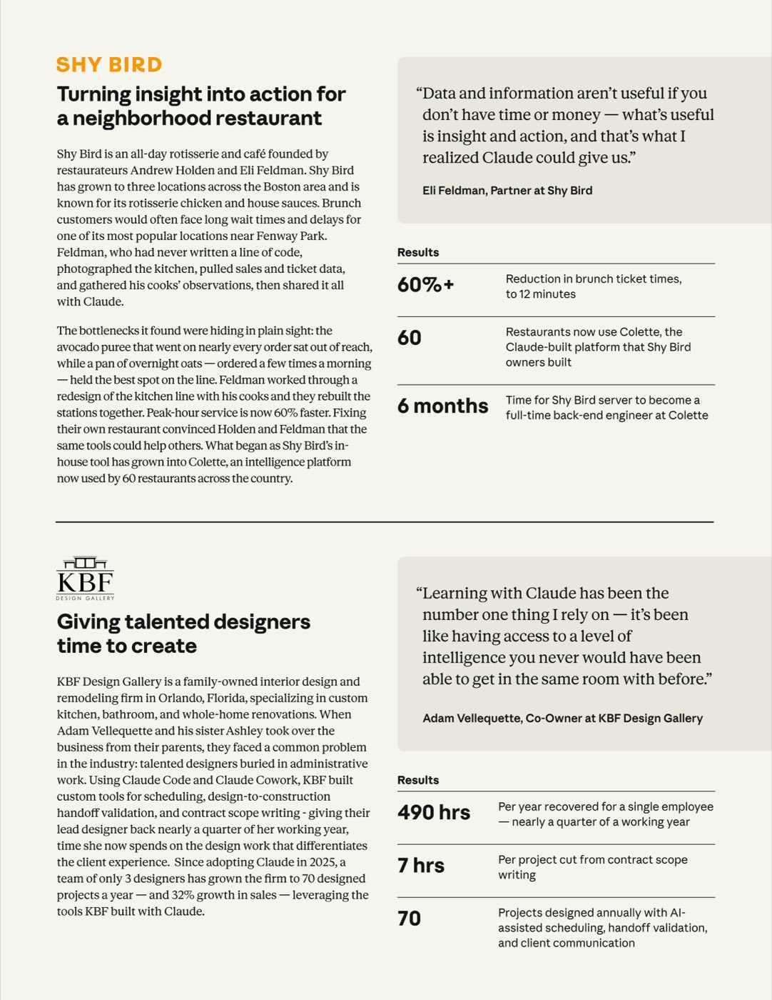

[SEC原圖](https://www.sec.gov/Archives/edgar/data/2130357/000162828026067168/a2026-09x17xcasestudyxshyb.jpg) · PDF實體頁238

Shy Bird以廚房照片、銷售及出單資料讓Claude協助找出工作站瓶頸，後續打造Colette。KBF利用Claude Code與Cowork製作排程、交接驗證及合約工具；原圖稱三名設計師達每年70件專案、銷售成長32%。兩者均為選定個案，不能直接推廣為所有中小企業的平均成效。

圖內標籤與重點：

- 縮短60%以上至12分鐘：Shy Bird早午餐出單時間
- 60家：使用Colette平台的餐廳
- 6個月：一位餐廳服務員轉為Colette全職後端工程師所需時間
- 490小時：KBF一名員工每年收回的工時
- 7小時：KBF每件專案合約範圍撰寫節省時間
- 70件：KBF每年設計專案數

| 數值 | 原圖對應意義 |
|---|---|
| 縮短60%以上至12分鐘 | Shy Bird早午餐出單時間 |
| 60家 | 使用Colette平台的餐廳 |
| 6個月 | 一位餐廳服務員轉為Colette全職後端工程師所需時間 |
| 490小時 | KBF一名員工每年收回的工時 |
| 7小時 | KBF每件專案合約範圍撰寫節省時間 |
| 70件 | KBF每年設計專案數 |

申報文件選定客戶案例／公司或客戶自報，非獨立因果驗證。

## 41. 治理架構

圖內標籤翻譯。

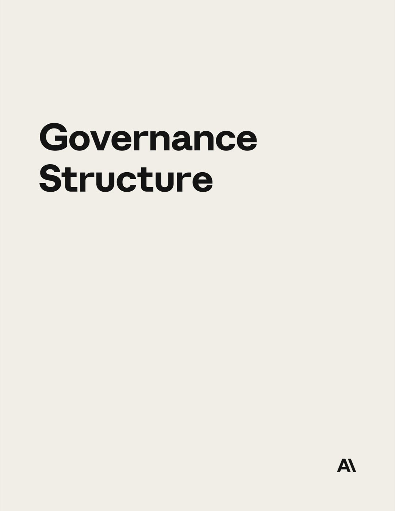

[SEC原圖](https://www.sec.gov/Archives/edgar/data/2130357/000162828026067168/a2026-10x24governancea.jpg) · PDF實體頁253

章節分頁，原文為Governance Structure。

圖內標籤與重點：

- 治理架構

## 42. Anthropic封底

品牌原名保留。

[SEC原圖](https://www.sec.gov/Archives/edgar/data/2130357/000162828026067168/a2026-10x24backxcovera.jpg) · PDF實體頁412

公司品牌名稱，保留原名。

## 製作說明

本頁由Codex研究模型完成讀圖、翻譯與整理，Tesseract文字辨識作輔助，未經人工逐句校稿。六組圖使用SVG重製，產品平台圖於HTML採可重排卡片。

[原始SEC文件](https://www.sec.gov/Archives/edgar/data/2130357/000162828026067168/anthropicpbc-sx1.htm) · [回到深度導讀](index.html)
